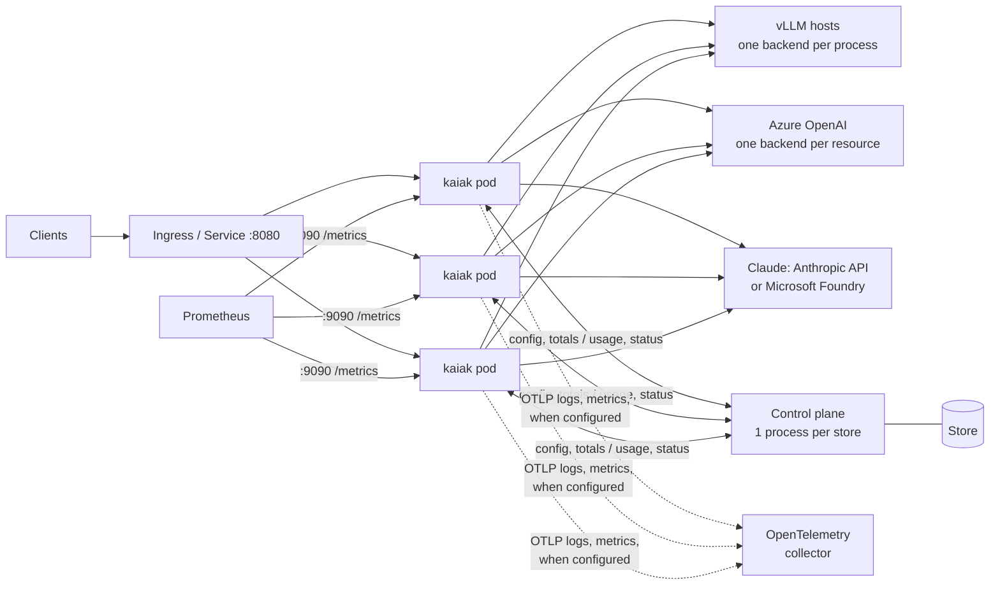

# Deployment

> The operator's guide: running kaiak for real — several gateway replicas on
> Kubernetes in front of many vLLM hosts, Azure OpenAI and Claude, fed by one control plane.
> It says what to set and why; the contracts it relies on live in
> `docs/specs/GATEWAY.md` and `docs/specs/CONTROL-PROTOCOL.md`, linked rather than
> restated. Kubernetes manifests are not part of this repo (the cluster setup is the
> operator's, `AGENTS.md` → Deployability); this guide names the fields they need.
> Local runs and image commands: `README.md`.

## Topology



- **Gateways**: N identical, **stateless** replicas — a Deployment behind one
  Service. Clients reach them through an ingress or the Service on the API port
  (`8080`). The admin port (`9090`) is never routed through an ingress.
- **Control plane**: as many processes as its store allows. With a store that holds
  the contract across processes (a database with conditional writes and a change
  channel — `CONTROL-PROTOCOL.md` → Control-plane processes), run replicas behind a
  Service, no stickiness, rolling updates included: a gateway whose replica goes away
  reconnects to another and resumes. With the in-memory store, one process. Running
  gateways never wait on it: an outage does not stop traffic (Control-plane outages,
  below) — but a gateway **starting** needs it, or a seed config (Boot).
- **The sample control plane is not a billing system.** Its store is in memory:
  budgets, usage totals and batch de-duplication reset every time it restarts (it
  says so in its log and on its page). Use it to validate the deployment. For real
  budgets, a control plane built on `kaiak-control` implements the storage interface
  (`control/kaiak-control/src/storage/types.ts`) on a durable store, and runs the
  library's store contract tests against it.
- **File mode is single-replica.** Without a control plane every replica enforces
  every limit and every backend cap in full — N replicas admit N × each limit. Run
  file mode as one gateway, or use a control plane.

## The minimal gateway

A gateway needs **only** `KAIAK_CONTROL_URL`, `KAIAK_CONTROL_TOKEN` and the API-key
variables its config names (`GATEWAY.md` → Configuration sources: the minimal
gateway). No volume, no seed: it writes nothing anywhere, so the root filesystem is
read-only. The fields a manifest needs:

| Field | Setting | Why |
|---|---|---|
| Workload kind | **Deployment**, `replicas` ≥ 2, `rollingUpdate` with a small `maxSurge` and `maxUnavailable: 0` | Nothing ties a pod to its node or its past: any pod can replace any other. |
| Image | `<registry>/kaiak:<tag>` or a digest, never `latest` | The tag is the version `kaiak_build_info` reports. |
| Ports | `8080` (API, behind the Service) and `9090` (admin: probes, metrics) | The admin port stays off the ingress (Observability). |
| Environment | `KAIAK_CONTROL_URL`; `KAIAK_CONTROL_TOKEN` from a Secret (`secretKeyRef`); one variable per `api_key_env` the config names, from Secrets; `GOMEMLIMIT` (Resources) | The whole configuration of a minimal gateway; every other variable (Environment) is optional. |
| Volumes | **none** | The gateway writes nothing. |
| Pod `securityContext` | `runAsNonRoot: true`, `runAsUser: 65532`, `runAsGroup: 65532`, `seccompProfile: {type: RuntimeDefault}` | The image's user (`USER 65532:65532`). |
| Container `securityContext` | `readOnlyRootFilesystem: true`, `allowPrivilegeEscalation: false`, `capabilities: {drop: [ALL]}` | Nothing to write, no privilege needed: ports above 1024. |
| Startup probe | `GET /healthz` on 9090, `periodSeconds: 2`, `failureThreshold: 35` (70 s) | Covers the boot wait (60 s by default) before liveness applies: Probes, below. |
| Readiness probe | `GET /readyz` on 9090, `periodSeconds: 5` | Probes, below. |
| Liveness probe | `GET /healthz` on 9090, `periodSeconds: 10` | Probes, below. |
| Resources | memory request = limit (1.75 GiB at the default body and upload budgets); a CPU request, no tight CPU limit | Resources. |
| `terminationGracePeriodSeconds` | grace + drain timeout + 10 s: **75** at the defaults | Draining. |

- **The securityContext passes the `restricted` Pod Security Standard.** The image
  declares a numeric user, so `runAsNonRoot` verifies even without `runAsUser`.
  No `fsGroup` is needed: there is no volume.
- **Instance ID**: leave `KAIAK_INSTANCE_ID` unset — it defaults to the hostname,
  the pod name. Every pod is a new instance with a fresh usage epoch; never copy one
  value to two replicas (the control plane flags it: `started-at-alternating`).
- **Rollouts** do not wait for drains: old pods drain while new ones serve. Each old
  pod stays in the control plane's live set until 30–35 s after its last status
  (`CONTROL-PROTOCOL.md` → Status intake), so per-minute shares and backend-cap
  shares shrink for a moment during a rollout — keep `maxSurge` small.
- **Probes** (admin port; neither needs a credential, also with
  `KAIAK_METRICS_TOKEN` set): `GET /readyz` → `200 ready`, `503 draining`;
  `GET /healthz` → `200 ok`, through the whole drain. The listeners bind only once a
  config is in force and the first totals have arrived (Boot, below), so a pod is
  ready from its first successful probe — and until then **every probe, liveness
  included, finds the port closed**. Startup normally takes well under a second,
  but while the control plane is unavailable it takes up to
  `KAIAK_CONTROL_BOOT_WAIT_MS` (60 s) before the gateway binds on its seed
  config, or exits. Give it a **startup probe** on `/healthz` that
  allows the boot wait plus margin — `periodSeconds: 2`, `failureThreshold: 35`
  (70 s) at the default — so the liveness probe never restarts a pod that is still
  waiting; with a shorter or longer boot wait, scale `failureThreshold` with it
  (wait ÷ period + a few). Without a startup probe, the equivalent is
  `initialDelaySeconds` on the liveness probe above the boot wait (70), which also
  delays liveness for every healthy start.

## Boot

`GATEWAY.md` → Control-plane mode: Boot has the full table. In short:

- The gateway opens the control plane's stream and takes its first config. While
  the control plane is **unavailable** (down, timing out, any `5xx`) it opens the
  stream again every 0.25–2 s (jittered) for up to `KAIAK_CONTROL_BOOT_WAIT_MS`
  (default 60 s); the first failure logs `config not received at startup: retrying
  within the boot wait`. A control plane with nothing published keeps the stream
  open: a config published within the wait arrives on it.
- With the config, it waits for the **first totals** (normally milliseconds: they
  follow the config on the stream) so it never serves a spent budget as unspent,
  then binds and serves (`waiting for the first totals` → `first totals
  received`). If the rest of the boot wait passes without them, it binds anyway
  and logs `first totals not received within the boot wait: priced USD-limited
  requests are refused until they arrive`: until they come, priced models under a
  `usd_per_month` limit answer `503 budget_unavailable`; everything else serves.
- **Unavailable through the whole wait**: it uses the seed config if one is set
  (Optional: the seed config), else **exits non-zero** with one log line (`no
  config: control plane unavailable and no seed config …`). Kubernetes restarts it
  with its backoff (`CrashLoopBackOff`, growing to 5 minutes between tries) — a pod
  that came back up waits for its next try, not for the control plane.
- **Refused token (`401`), another `4xx`, or a config the gateway rejects**: it
  exits at once, seed or not — no retry. These are errors to fix, not outages to
  ride out: the log line names the cause (`… answered 401 unauthorized …`, `… the
  control plane's config was rejected (codes …)`).
- **During a control-plane restart** (a rollout, a crash, a node drain — back
  within the minute): running pods keep serving and reconnect on their own. A pod
  starting meanwhile shows `retrying within the boot wait`, stays unready (the
  admin port is closed), and binds within a second of the control plane answering
  — no crash loop. `kaiak_control_connected` of the running pods drops to 0 and
  returns.
- **Consequence**: during a control-plane outage longer than the boot wait, running
  pods keep serving, but a pod that restarts, is rescheduled or is added by scaling
  does not start — unless a seed is set. Keep the control plane up, or set a seed.

## Control-plane outages

A running gateway keeps everything in memory and never waits on the control plane
(`GATEWAY.md` → Limits: Control-plane mode; `CONTROL-PROTOCOL.md` → Control-plane
outage):

- It serves on the config in force. Config changes and key revocations do not
  arrive until the stream is back.
- Per-minute limits and backend caps keep their last shares; hour and month limits
  run on the last pushed totals plus local counting.
- **After `global.control_outage_grace_ms`** (default 15 min) with no contact,
  requests for a **priced model under a `usd_per_month` limit** are refused `503
  budget_unavailable`: nobody knows the spend. Free models and models under no USD
  limit keep serving. The first contact ends it. The log says so once each way:
  `control plane outage: priced USD-limited models refused` (warn) and `control
  plane outage over: contact is back` (info).
- **Usage waits in memory, bounded per pod by `KAIAK_USAGE_MEMORY_BYTES`** (default
  64 MiB of encoded records, shown by `kaiak_usage_queue_size_bytes`): past that, the
  oldest queued batches are dropped, logged at error level and counted in
  `kaiak_usage_dropped_records_total{kaiak_usage_drop_reason="memory_bound"}`
  (`GATEWAY.md` → Usage batches in memory). **What the default covers**: a typical
  record encodes to about 510 bytes (measured 506 with 32-character record and
  request IDs, a pod-name instance, ordinary key and model names and a short group
  path; a
  client-chosen request ID of up to 128 characters adds up to about 100), so 64 MiB
  holds about 130 000 records:

  | Records/s per pod | Outage the default holds |
  |---|---|
  | 20 | about 110 min |
  | 100 | about 22 min |
  | 145 | 15 min — the default outage grace |
  | 1 000 | about 2 min |

  Records are at least requests: a retried attempt sent in full adds one. Past the
  grace only priced USD-limited models are refused, so free models keep adding
  records for as long as the outage lasts. **To hold an outage of T seconds at R
  records/s**, set `KAIAK_USAGE_MEMORY_BYTES` to about R × T × 520 — 1 000
  records/s through 15 min is about 470 MB, `536870912` (512 MiB) — and add it to
  the memory limit (Resources). Longer outages than that lose billing data.

## Draining and what a pod loses

**Draining** (`GATEWAY.md` → Lifecycle): on SIGTERM `/readyz` fails; requests are
still accepted for the grace period (`KAIAK_DRAIN_GRACE_MS`, default 5 s — endpoint
removal takes time to reach kube-proxy and the ingress); then new connections are
refused, and in-flight requests, streams included, get the drain timeout
(`KAIAK_DRAIN_TIMEOUT_MS`, default 60 s) **less the flush reserve**
(`KAIAK_DRAIN_FLUSH_RESERVE_MS`, default 10 s, at most half the timeout when unset).
Requests still running then are cut, and their partial usage records go out with
the rest in the reserve. Usage batches keep going out every 5 s throughout the
drain; then a final status (≤ 2 s), the admin listener closes (≤ 5 s for a scrape
still open), with metric export on a final export of the metrics, with log export
on the last queued log lines (each given at least 1 s), and the process exits 0. The `draining` log line names the times in
force, in seconds: `kaiak.drain.grace`, `kaiak.drain.timeout`,
`kaiak.drain.flush_reserve` and `kaiak.drain.cut_after` — when requests still
running are cut, counted from the grace's end (the timeout less the reserve; the
whole timeout in file mode).

- **`terminationGracePeriodSeconds` ≥ grace + drain timeout + 10 s**: 75 s at the
  defaults. The Kubernetes default of 30 s kills long streams mid-drain and skips
  the flush. Docker and Compose have the same limit under another name, with a 10 s
  default: `docker run --stop-timeout 75`, `stop_grace_period: 75s` in Compose.
- **Size the drain timeout to the longest request a rollout should let finish, plus
  the reserve.** A thinking model streaming 16k tokens at 30 tokens/s runs about 9
  minutes; a non-stream request can run up to its backend's `response_timeout_ms`
  (default 30 min). To let 10-minute requests finish: `KAIAK_DRAIN_TIMEOUT_MS=610000`
  (600 s + the 10 s reserve), `terminationGracePeriodSeconds: 625`.
- **`preStop` is not needed**: the grace period is the propagation wait, and the
  distroless image has no shell or `sleep` for one. When the path from the endpoint
  change to the last load balancer takes longer than 5 s (a cloud load balancer
  deregistering targets), raise `KAIAK_DRAIN_GRACE_MS` instead.
- A second SIGTERM skips the rest of the drain (requests cut at once, the last batch
  sealed but not waited for, no final status).

**What a pod loses**:

| How it ends | Lost usage |
|---|---|
| Drained, control plane answering | nothing |
| Drained, control plane unreachable or slow | what the flush could not deliver — logged at error level, `usage not flushed: lost at exit`, with the batches and records |
| Killed without a drain (OOM kill, node loss, SIGKILL after the grace period) | every record not yet acknowledged: normally the last ≤ 5 s; during an outage, everything queued (up to `KAIAK_USAGE_MEMORY_BYTES`, about 130 000 records at the default) |

Nothing else is lost: config and totals come back from the control plane.

## Resources

- **Memory ≈ 2 × body budget + upload budget + open streams × ~70 KiB + non-stream
  `choices` in flight + headroom.** Request bodies are bounded by the body budget
  (`KAIAK_BODY_MEMORY_BYTES`, default 512 MiB); peak body memory is about twice the
  budget (the provider's edited copy while an attempt is sent — at most the body plus
  one edit per owned field, since a body repeating a member is refused — plus parse
  garbage; `GATEWAY.md` → Request pipeline: request bodies). **Uploads** (image edits,
  speech-to-text) take their own budget (`KAIAK_UPLOAD_MEMORY_BYTES`, default 256
  MiB), once: the body sent to the backend is written from the upload's own bytes,
  never copied (Uploads, below). Count it whether or not a model serves uploads — an
  upload is read before the model's list is checked, so any key can fill it.
  **Each open stream**
  keeps about 70 KiB of live heap (measured in the daily-operations review,
  2026-09-25), about 130 KiB of
  resident memory without `GOMEMLIMIT` (the collector lets garbage grow to twice the
  live heap); memory, not CPU, is what runs out first under many streams. Outside
  both, each non-stream answer in flight keeps its `choices` (up to 4 MiB, usually
  KiB) to estimate output when a backend reports no usage. Headroom covers idle
  connections, metrics series, limit counters (at most 50 000 a config allocates,
  under about 70 MB: Config for many hosts), the usage queue (up to `KAIAK_USAGE_MEMORY_BYTES`,
  64 MiB; its heap is about its encoded size), with log export on its queue (at most
10 000 records, about 10 MB) and the runtime. Starting point:
  **limit = 2 × body budget + upload budget + 512 MiB** (1.75 GiB at the default
  budgets) with
  `GOMEMLIMIT` set, good for about 5 000 open streams per pod alongside ordinary
  bodies; beyond that add 70 KiB for each stream above 5 000 (10 000 streams: about
  350 MiB more), plus
  whatever `KAIAK_USAGE_MEMORY_BYTES` is raised by above 64 MiB; memory request =
  limit. The body budget is rarely full while thousands of streams run (a body goes
  back to the budget once its response starts relaying), so this is conservative.
  Lower the budget for a smaller pod — 256 MiB serves 64 bodies at the 4 MiB cap and thousands
  of ordinary requests. Then watch the working set under real load.
- **`GOMEMLIMIT`** makes the Go collector work harder before the kernel kills the
  pod. From the downward API (`valueFrom: {resourceFieldRef: {resource:
  limits.memory}}` — bytes) it follows the limit with no
  second number to keep in step, set at 100% of it; a literal value at about 90%
  (`GOMEMLIMIT=1600MiB` for 1.75 GiB) leaves the collector more room. It is a soft
  limit; the body and upload budgets are the hard bounds on what clients can pin.
- **CPU**: the gateway is I/O-bound (it splices a few fields into bodies and parses
  SSE framing; no tokenizer). Go sizes `GOMAXPROCS` from the container's CPU limit.
  Set a CPU request; a tight CPU limit throttles every stream at once and shows up as
  stream latency — prefer no limit or a generous one.
- **Disk**: none.

## Availability

- **PodDisruptionBudget** for the gateways — `maxUnavailable: 1` (or a
  `minAvailable` that leaves capacity for the load) — so node drains and cluster
  upgrades take pods one at a time, each draining in full. Not for the control
  plane: one replica with a PDB blocks every node drain; its outage is what the
  gateways ride out.
- **Spread the replicas**: `topologySpreadConstraints` over
  `topology.kubernetes.io/zone` and `kubernetes.io/hostname` (`maxSkew: 1`,
  `whenUnsatisfiable: ScheduleAnyway`), or a preferred pod anti-affinity on the
  hostname — one node's loss should not take most gateways, since a pod killed
  without a drain loses its unacknowledged usage.
- **Load-balancer idle timeouts vs the gateway's**: the gateway closes idle
  keep-alive connections after 120 s (`KAIAK_IDLE_TIMEOUT_MS`). A proxy that keeps
  upstream connections idle longer sends requests into connections the gateway is
  closing (sporadic `502`s): keep the proxy's upstream idle timeout below the
  gateway's (ingress-nginx's upstream keep-alive timeout is 60 s). A cloud load
  balancer whose idle timeout you raise above 120 s for long non-stream requests
  (an AWS ALB cuts a request that sends no bytes for its idle timeout, 60 s by
  default) needs `KAIAK_IDLE_TIMEOUT_MS` raised above it too.
- **Private CAs**: backends and the control plane are reached with the system trust
  store. The image sets `SSL_CERT_FILE` to its public bundle; to add a private CA,
  mount its PEM file(s) from a ConfigMap or Secret as a directory and set
  `SSL_CERT_DIR` to it — Go reads both the file and every file in the directory, so
  the public roots stay (Azure needs them). Replacing `SSL_CERT_FILE` instead drops
  the public roots unless your bundle carries them.
- **Monthly budgets reset at the UTC month boundary** (hours are UTC hours too —
  `GATEWAY.md` → Limits): a group whose people work in UTC+3 sees its budget reset at
  03:00 on the 1st.
- **The sample control plane**: `replicas: 1`, `strategy: Recreate` — its store is in
  memory, one process (its `KAIAK_SAMPLE_PROTOCOL_PORTS` replicas share that one
  process: a demonstration, not a deployment). It has **no
  health endpoint** — use a TCP probe on 8090 for readiness and liveness (its page,
  `GET /`, renders every gateway and spend, heavier than a probe needs). Starting
  resources: 100m CPU, 256 MiB memory (its store keeps a bounded number of recent
  records); watch it. It runs with the same securityContext as the gateway with
  `runAsUser: 1000`, `runAsGroup: 1000` (the image's `USER 1000:1000`),
  `readOnlyRootFilesystem: true` included.

## Environment

Every variable the code reads (verified by grep over `gateway/cmd`, `gateway/internal`,
`control/sample/src`, the Dockerfiles and `scripts/`), except development tooling:
the live-backend kit's `LIVE_*` (`docs/testing/LIVE-BACKENDS.md`) and npm's
`INIT_CWD` (the sample resolves a relative `KAIAK_SAMPLE_CONFIG` against the
directory `npm` ran from; unset in the image, where the working directory counts).
Durations are whole milliseconds; a malformed value is a startup error.

**Gateway** (`gateway/cmd/kaiak/settings.go`; contract: `GATEWAY.md` → Configuration
sources):

| Variable | Default | Meaning |
|---|---|---|
| `KAIAK_CONFIG_FILE` | — | File mode: the config file. Not with `KAIAK_CONTROL_URL`. |
| `KAIAK_CONTROL_URL` | — | Control-plane mode: the control plane's base URL (`http(s)://host[:port][/path]`, no query); `https://` outside local runs. Requires `KAIAK_CONTROL_TOKEN`. |
| `KAIAK_CONTROL_TOKEN` | — | The bearer token presented to the control plane (a Secret; shared by all gateways). |
| `KAIAK_CONTROL_BOOT_WAIT_MS` | `60000` | How long boot keeps asking an unavailable control plane for the config before using the seed config, or exiting; what is left of it bounds the wait for the first totals (above 0). Size the startup probe with it (Probes). |
| `KAIAK_SEED_CONFIG_FILE` | — | Control-plane mode only: config for a boot while the control plane is unavailable; free models only, checked completely at startup. |
| `KAIAK_INSTANCE_ID` | the hostname | The gateway's name to the control plane; in control-plane mode a letter or digit, then up to 252 of letters, digits, `.`, `_`, `-`. |
| `KAIAK_LISTEN_ADDR` | `:8080` | The API listener. |
| `KAIAK_ADMIN_ADDR` | `:9090` | The admin listener (`/metrics`, `/healthz`, `/readyz`). |
| `KAIAK_METRICS_TOKEN` | — (open) | When non-empty, `/metrics` requires `Authorization: Bearer <token>`; probes stay open. |
| `KAIAK_LOG_FORMAT` | `json` | `json` or `text`. |
| `KAIAK_DRAIN_GRACE_MS` | `5000` | Drain: how long new requests are still accepted after SIGTERM (0 or more). |
| `KAIAK_DRAIN_TIMEOUT_MS` | `60000` | Drain: how long in-flight requests get before they are cut (0 or more). |
| `KAIAK_DRAIN_FLUSH_RESERVE_MS` | `10000` (at most half the timeout when unset) | Control-plane mode: the end of the drain timeout kept for the usage flush; in-flight requests are cut that much earlier (0 up to the timeout). |
| `KAIAK_IDLE_TIMEOUT_MS` | `120000` | Idle keep-alive connections are closed after this (above 0). |
| `KAIAK_BODY_READ_TIMEOUT_MS` | `60000` | A request body must arrive within this, else `400 invalid_body` (above 0). |
| `KAIAK_UPLOAD_READ_TIMEOUT_MS` | `300000` | An upload's body (image edits, speech-to-text) must arrive within this, in place of the body-read timeout, else `400 invalid_body` (above 0; Uploads). |
| `KAIAK_WRITE_TIMEOUT_MS` | `60000` | Each write to a client must complete within this; a client that stops reading is taken as gone (above 0). |
| `KAIAK_BODY_MEMORY_BYTES` | `536870912` (512 MiB) | The body budget (Resources); above 0. |
| `KAIAK_UPLOAD_MEMORY_BYTES` | `268435456` (256 MiB) | The upload budget, a pool apart from the body budget (Uploads, Resources); above 0. |
| `KAIAK_USAGE_MEMORY_BYTES` | `67108864` (64 MiB) | Control-plane mode: the bound on unacknowledged usage held in memory, by encoded size (Control-plane outages); above 0. |
| `KAIAK_MAX_CONNECTIONS` | `0` (no cap) | The most connections the API listener keeps open, idle keep-alive ones included; beyond it a connection is closed at accept (Secrets and trust: connection floods); 0 or more. |
| `OTEL_EXPORTER_OTLP_ENDPOINT` | — | OTLP export (Observability: OTLP export), both signals: the collector's base URL (`http://collector:4318`); `/v1/logs` and `/v1/metrics` are appended. Setting it turns log and metric export on. |
| `OTEL_EXPORTER_OTLP_LOGS_ENDPOINT`, `OTEL_EXPORTER_OTLP_METRICS_ENDPOINT` | — | One signal's URL, used as is (`http://collector:4318/v1/logs`); it wins over the general one for that signal, and setting it turns that signal on. |
| `OTEL_LOGS_EXPORTER`, `OTEL_METRICS_EXPORTER` | — | `none` turns that signal's export off whatever else is set; `otlp` turns it on, to `http://localhost:4318/v1/logs` or `…/v1/metrics` when no endpoint is set. |
| `OTEL_SDK_DISABLED` | `false` | `true` turns both exports off. |
| `OTEL_EXPORTER_OTLP_HEADERS`, `OTEL_EXPORTER_OTLP_LOGS_HEADERS`, `OTEL_EXPORTER_OTLP_METRICS_HEADERS` | — | Headers sent with each export, `key=value,…`, values percent-encoded (a backend's API key: a Secret). Never logged. The signal's variable wins. |
| `OTEL_EXPORTER_OTLP_TIMEOUT`, `OTEL_EXPORTER_OTLP_LOGS_TIMEOUT`, `OTEL_EXPORTER_OTLP_METRICS_TIMEOUT` | `10000` | How long one request may take, retries included (above 0): a log batch; for metrics, within the export timeout. The signal's variable wins. |
| `OTEL_EXPORTER_OTLP_PROTOCOL`, `OTEL_EXPORTER_OTLP_LOGS_PROTOCOL`, `OTEL_EXPORTER_OTLP_METRICS_PROTOCOL` | `http/json` | Only `http/json`; `grpc` or `http/protobuf` fail the start. |
| `OTEL_METRIC_EXPORT_INTERVAL` | `60000` | Metric export: the time between exports (above 0). |
| `OTEL_METRIC_EXPORT_TIMEOUT` | `30000` | Metric export: the bound on one export, retries and split requests included (above 0); the shorter of it and the OTLP timeout applies — 10 s at the defaults. |
| `OTEL_EXPORTER_OTLP_METRICS_TEMPORALITY_PREFERENCE` | `cumulative` | `cumulative`, `delta` or `lowmemory` (any case): what the pushed sums and histograms carry (Observability: OTLP export). `/metrics` is always cumulative. |
| `OTEL_SERVICE_NAME` | `kaiak` | The `service.name` of the resource both exports carry. |
| `OTEL_RESOURCE_ATTRIBUTES` | — | More resource attributes, `key=value,…` (`deployment.environment.name=prod`); `service.version` and `service.instance.id` are always the gateway's own. |

Also read by the gateway (Go runtime and standard library): every backend's
`api_key_env` (Secrets); `GOMEMLIMIT` (Resources); `SSL_CERT_FILE` (the image sets
its bundle) and `SSL_CERT_DIR` (Availability: private CAs); and
`HTTP_PROXY`/`HTTPS_PROXY`/`NO_PROXY` for both backend and control-plane
connections and the OTLP export — when the cluster sets a proxy, list in-cluster
backends, the control plane and the collector in `NO_PROXY`.

**Sample control plane** (`control/sample/src/settings/index.ts`):

| Variable | Default | Meaning |
|---|---|---|
| `KAIAK_SAMPLE_CONFIG` | — (required) | The config file it serves and watches (mount the ConfigMap's directory, not a `subPath` file). |
| `KAIAK_CONTROL_TOKEN` | — (required) | The token gateways must present. |
| `KAIAK_SAMPLE_LISTEN` | `127.0.0.1:8090` (the image sets `0.0.0.0:8090`) | `host:port`; `[addr]:port` for IPv6. |
| `KAIAK_SAMPLE_PROTOCOL_PORTS` | none | Comma-separated ports on the `KAIAK_SAMPLE_LISTEN` host, each a protocol replica: another control-plane core over the sample's one in-memory store, serving only the gateway endpoints (`0` picks a free port). A demonstration of several control-plane processes over one store, inside one process. |
| `KAIAK_LOG_FORMAT` | `json` | `json`, or `text` (not in the image: needs a dev dependency). |

**Image build** (`scripts/build-images.sh`; flags win): `KAIAK_DOCKER_CONTEXT`
(default: the current Docker context), `KAIAK_BUILDX_BUILDER` (default: the context's
default builder), `KAIAK_IMAGE_REPO` (required: the registry and namespace, e.g.
`registry.example.com/team`).

## Clients

- **The client APIs on the one API port** (`GATEWAY.md` → Client API): OpenAI's
  chat completions, completions, embeddings and models; Anthropic Messages
  (`/v1/messages`, `/v1/messages/count_tokens`, and `/v1/models` in Anthropic's shape
  when the request carries `anthropic-version`); OpenAI Responses (`/v1/responses`,
  `/v1/responses/input_tokens`); rerank (`/v1/rerank`; Rerankers, below); speech
  (`/v1/audio/speech`, and vLLM-Omni's `/v1/audio/speech/batch`) and image
  generation (`/v1/images/generations`; Speech and images, below); image edits
  (`/v1/images/edits`) and speech-to-text (`/v1/audio/transcriptions`), which take
  uploads (Uploads, Image edits, Speech-to-text, below). One key works on all of
  them, as `Authorization: Bearer` or `x-api-key`.
- **Passthrough only** (settled 2026-10-06): a request reaches only a backend that
  speaks its API natively, never translated. Every model lists the endpoints it
  serves, each one its backend type serves, and its deployments are all of one type
  (Endpoints per model, below); a request for an endpoint the model does not list
  answers `400 endpoint_not_served` before any backend. So a Claude model on
  `anthropic` or `azure-anthropic` is reachable through Messages only, an OpenAI or
  Azure OpenAI model through OpenAI's endpoints and Responses, a vLLM or
  llama-server model through what the model it loaded answers among those four and
  speech-to-text, a vLLM-Omni model through speech, the speech batch, image
  generation or image edits. `/v1/models` lists each model's `endpoints`.
  Responses `input_tokens` is served by `llama-server` and `openai` only, rerank and
  speech-to-text by `vllm` and `llama-server` only, the other media endpoints by
  `vllm-omni` only.
- **Responses is stateless**: every request goes out with `store: false`, and
  `previous_response_id`, `conversation` and `background` are refused — clients
  send the whole conversation each turn. **Tools a backend would run** (web search,
  code execution, remote MCP, …) are refused on both APIs.
- **Client settings** (`docs/testing/LIVE-BACKENDS.md` → Client checks):
  - Claude Code: `ANTHROPIC_BASE_URL=https://<gateway>` (no `/v1`),
    `ANTHROPIC_AUTH_TOKEN=<kaiak key>`, `ANTHROPIC_MODEL=<public model>`. Its
    WebSearch tool is refused (a hosted tool); on Anthropic and Foundry backends a
    1-hour prompt cache is refused too — keep its default 5-minute cache.
  - Codex: a custom provider with `base_url = "https://<gateway>/v1"` and
    `wire_api = "responses"`; if its requests are refused naming `web_search`, set
    **`web_search = "disabled"`** — its default may attach a hosted search tool,
    which is refused (not yet checked live against a custom provider).
- **A path the server does not have** (`GATEWAY.md` → Providers: A path the server
  does not have; settled 2026-10-11): a backend answering, on an endpoint the model
  lists, the way its server answers a path it does not have answers the client `502
  upstream_path_missing` at once — not retried (the model's other deployments are
  identical instances), not a circuit failure, no usage. Both causes are the
  operator's, and the message names both: the backend's `base_url` is wrong
  (typically the API version path left out), or the model's list names an endpoint
  its server does not serve — vLLM creates its routes from the model it loaded (an
  embedding model has no chat route), and an older vLLM has no `/v1/messages`. The
  deployment stays in rotation, so **a mistyped `base_url` fails its share of the
  model's requests until it is fixed**: the config-apply warning `the backend has no
  models list at its base_url` and the `path_missing` attempts show it
  (Observability: Wrong model, path or credential). llama-server and vLLM-Omni
  register every route whatever their model, so on them only a wrong `base_url`
  gets this answer; a wrong list gets the server's own (Endpoints per model,
  below).

## Config for many hosts

The config document's fields and defaults: `protocol/schema/config.schema.json`;
how the gateway acts on them: `GATEWAY.md` → Routing and reliability. A worked
example: `examples/config.json`. Twenty hosts × a few models is repetitive — generate
the document (a script, or the control plane) rather than editing it by hand.

- **A backend's `type` is its server's** (`GATEWAY.md` → Providers): `vllm`,
  `vllm-omni` (vLLM-Omni: Speech and images, below), `llama-server` (llama.cpp),
  `openai` (OpenAI's API, `https://api.openai.com/v1`), `azure-openai` (Azure
  OpenAI, below), `anthropic` and `azure-anthropic` (Claude, below), and
  `openai-compatible` only for a server without a type of its own (SGLang, …). A
  backend answers the same under any of the OpenAI-format types, but only its own
  type carries that server's rules — and **the type decides which client APIs reach
  the model** (Clients, below): `openai-compatible` serves OpenAI's chat,
  completions and embeddings only, so a vLLM or llama-server host listed under it
  loses Messages, Responses, rerank and speech-to-text. `openai`
  and `azure-openai` require `api_key_env` and **force the standard service tier**: a
  client's `service_tier` becomes `"default"` and every chat and Responses request
  carries it, so requests are billed at the standard rates `prices` holds. `vllm`,
  `vllm-omni`, `llama-server` and `openai-compatible` pass the client's
  `service_tier` untouched and add none —
  **an OpenAI deployment kept as `openai-compatible` runs on the tier the client asks
  for, or the project's own**, and priority bills about twice the configured prices.
  The sample's `verify` (`kaiak-control`'s `verifyBackend`) notes a vLLM or
  llama-server answer under another type.
- **One backend per vLLM process** (one URL = one process and port), with
  **`max_in_flight` = what that process takes** — typically its `--max-num-seqs`, or
  lower if latency at full batch is too high. Requests past it wait in the
  gateway's queue, where the wait is visible and bounded, instead of queueing unseen
  inside vLLM (where the wait also eats into the first-event timeout). The cap is
  the backend's whole capacity: in control-plane mode each gateway enforces
  `ceil(max_in_flight ÷ live gateways)` automatically (overshooting by at most one
  request per gateway); in file mode the one gateway enforces all of it. Known
  limit: a gateway with more demand queues while others' shares sit idle — the
  demand-weighted split is in `docs/BACKLOG.md` (revisit when `queue_full` or
  `queue_timeout` appears while the fleet's in-flight is below the caps).
  Cloud backends usually need no cap. **A slot is one HTTP request, not one
  sequence**: a completions request with a prompt list, or `n`/`best_of` above 1,
  generates several sequences in the one slot — up to
  `global.max_sequences_per_request` (default 16), an embeddings request carries
  up to `global.max_embedding_inputs` (default 2048) inputs, a rerank request
  up to `global.max_rerank_documents` (default 1000) documents, each scored with the
  query, an image generation or edit up to `global.max_images_per_request` (default
  10) images and a speech batch up to `global.max_speech_batch_items` (default 32)
  items. Size
  `max_in_flight`
  with that in mind (below `--max-num-seqs` when clients batch), and keep the
  backend's own batch limits in place — vLLM's `--max-num-seqs` and
  `--max-num-batched-tokens`, llama-server's `--parallel` and `--batch-size` — as the
  bound the gateway does not enforce.
- **One public model, many deployments**: list every host serving a model as a
  deployment of it — hosts of one backend type, the same server and model on each
  (Endpoints per model, below); the least-loaded deployment wins, retries go to
  another (never the same one: the client's SDK retries that), open circuits and
  deployments cooling down after a `429` are skipped. A single-deployment model is
  not retried by the gateway. Two public models may share deployments (the
  example's `qwen3-32b` and `qwen3-32b-thinking`: same hosts, different output
  limits).
- **Every model lists its `endpoints`** — what its server answers (Endpoints per
  model, below).
- **A deployment's `model` is the name the backend lists** (`GET <base_url>/models`),
  in its own naming: vLLM's `--served-model-name`, Azure's deployment name,
  llama-server's model id — by default its file path
  (`/models/qwen3-embedding-0.6b-q8_0.gguf`), accepted as it is (1 to 512 printable
  ASCII characters, no spaces). Or give llama-server `--alias <name>` and use that.
  The gateway warns at each config apply for a deployment its backend does not
  list, and for a backend the check cannot read: one that does not answer (a
  mistyped host, a server down), or whose models list is not at its `base_url`.
- **Timeouts, per backend** (`GATEWAY.md` → Routing and reliability: Timeouts):

  | Field | Default | Size it to |
  |---|---|---|
  | `connect_timeout_ms` | 5 s | the network; rarely changed. |
  | `first_event_timeout_ms` | 60 s | streams: the longest prefill you accept at full load (long prompts on a busy host). Running out is retried elsewhere and counts toward the circuit, so too low a value turns slow hosts into "failing" ones; the example uses 120 s. |
  | `response_timeout_ms` | 30 min | non-stream requests: the longest whole generation, thinking included (16k tokens at 30 tokens/s ≈ 9 min). Not retried, not a circuit failure — except a half-open trial's, and from the 3rd in a row on one deployment (a hung engine). |
  | `stall_timeout_ms` | 120 s | streams: the longest silence between data events (keep-alive comments do not count). vLLM thinking models stream their reasoning, so there this is about a hung engine, not a long thought — models that reason silently are another matter (Azure OpenAI: reasoning deployments). |

  Whatever sits in front of the gateway must allow as much: an ingress or proxy read
  timeout below these cuts the request first (ingress-nginx's default
  `proxy-read-timeout` is 60 s; set it above the longest non-stream generation).
  Streams carry `X-Accel-Buffering: no`, so nginx-style proxies do not buffer them.
- **Body size** (`global.max_request_body_bytes`, default 4 MiB): enough for chat
  with long contexts and a few images, not for everything. Azure vision requests
  carry images base64-encoded (a third larger than the files), and a long-context
  model (gpt-4.1: about 1M tokens, several MB of text) can take a prompt far above
  4 MiB; both answer `413 request_too_large`. To raise it, raise three things
  together: `max_request_body_bytes`; the ingress body-size limit (ingress-nginx's
  `proxy-body-size` defaults to 1 MiB — below even the gateway's default); and the
  body budget `KAIAK_BODY_MEMORY_BYTES` with the memory limit (Resources) — the
  effective cap is the smaller of the cap and the whole budget, and the budget
  divided by the cap is how many maximum-size bodies a pod holds at once. Uploads
  have a cap and a budget of their own (Uploads, below).
- **`global.max_n`** (default 8): the largest `n`/`best_of` a request may ask for;
  the token reservation multiplies by it, so keep it low.
- **`global.max_sequences_per_request`** (default 16),
  **`global.max_embedding_inputs`** (default 2048, OpenAI's own limit),
  **`global.max_rerank_documents`** (default 1000, the most Cohere's rerank API
  recommends), **`global.max_images_per_request`** (default 10) and
  **`global.max_speech_batch_items`** (default 32, vLLM-Omni's own maxima): what
  one request may make a backend generate, embed or score in its one slot (`n` or
  `best_of` × a completion's prompts; an embeddings request's inputs; a rerank
  request's documents; an image request's `n`; a speech batch's items), past them
  `400 invalid_value`. Raise them only as far as the backends' own batch limits
  allow.
- **`global.max_concurrent_requests_per_key`** (default 16): the most requests one
  key may have open at once on one gateway, past it `429
  concurrency_limit_exceeded`. Per gateway, so N replicas allow N × it. Raise it
  for a batch workload that runs many requests in parallel on one key.
- **Request defaults are the backend's** (`GATEWAY.md` → Model metadata, settled
  2026-10-06): the gateway fills in no sampling or template parameters — the models
  carry no `defaults` — so set them where the model runs: vLLM's
  `--generation-config` (the model's own `generation_config.json` by default) and its
  chat-template options, llama-server's sampling flags and `--chat-template-kwargs`.
  A host whose defaults differ from another's is another model, not another
  deployment of it. What the gateway still sets is the output
  limit: `output_limit` `default` and `ceiling` per model — the default is lowered to
  fit the prompt's room in `context_length`, never below 256; each client API takes
  it under its own key (`max_completion_tokens`, `max_tokens`, `max_output_tokens`).
- **`child_defaults` is a default, not a ceiling** (`CONTROL-PROTOCOL.md` → Config:
  The group tree): a child's own `allowed_models` or limit of the same type replaces
  the default, so it can loosen it. Put a hard restriction for a
  subtree — the models and budget no person under `users` may exceed — on the
  parent's **own** `allowed_models` and `limits`, which bind every group below it.
- **Counters are bounded at 50 000** (`counters-exceeded`): every gateway keeps five
  counters for global and for every group, limited or not — the hour counts of
  tokens, images, audio generated and audio processed, and the USD month — plus one
  counter per effective per-minute limit (a group's own merged with its parent's
  `child_defaults.limits`). A per-minute counter is about 1.4 KB and an hour or month
  one a few hundred bytes, so the bound keeps counters under about 70 MB of heap per
  pod (part of the headroom in Resources). Groups and defaults multiply: 5 000 people
  under a `users` group with 2 default per-minute limits are 35 000 counters.
- **A group ID used again resumes its spend**: a group deleted and created again with
  the same ID (a move included) within the hour or month gets that window's spend
  back. Use a new ID for a fresh budget.
- **Per-minute limits and replicas**: in control-plane mode each gateway enforces
  `floor(limit ÷ live gateways)`. A Service balances connections, not requests, and
  HTTP keep-alive pins a client to one replica, so a scope driven by a single client
  gets about one share, not the whole limit (known limit; demand-weighted shares in
  `docs/BACKLOG.md`). Size per-minute limits with that in mind, or rely on hourly
  limits, which the control plane counts across replicas. Each apply logs a warning
  for a per-minute token limit whose share is below the default output of a model its
  scope may use.
- **Token limits reserve the whole output limit while a request runs**
  (`GATEWAY.md` → Limits: check and reserve). A request is admitted against a
  `tokens_per_minute` or `tokens_per_hour` limit only if its **reservation** fits:
  its input estimate (about 4 bytes of text per token; **1000 tokens per image,
  audio clip or file**, whatever its size; one per token ID) plus its effective
  output limit — the client's `max_completion_tokens`/`max_tokens` up to the model's
  ceiling, else the model's default — times its sequences (`n`, `best_of`, a
  completion's prompts). The reservation stands until the request ends, then is
  replaced by the tokens actually processed — plain input, input written to the
  cache and output; **input read from the cache does not count**, since a
  prefix-cache hit costs the backend almost nothing (an agent resending a long
  context every turn settles at its new tokens, not the whole context). So a limit
  counts what requests *might* use while they run: a workload keeping 20 requests
  open on a model with a 4096 default and 2000-token prompts holds about
  20 × (2000 + 4096) ≈ 122 000 tokens of reservations at once, though it may settle
  at a fraction of that. **Size a per-minute token limit** to at least the scope's
  peak concurrent requests × (typical input + the output limit they run under) —
  cache reads included: leaving them out of the count does not lower this floor,
  since admission reserves the full input estimate, cached or not (only the
  settled amount is lower, so the room frees sooner) —
  per gateway: in control-plane mode each gateway holds `floor(limit ÷ live
  gateways)` (above), and one reservation larger than that share waits for the
  gateway's window to empty. A request whose reservation exceeds the **full** limit
  is refused as too large (`429`, the message names the tokens needed), so the limit
  must exceed the model's output ceiling (× `n`) plus the longest prompt allowed.
  Keep `output_limit.default` near what answers need (not the ceiling): clients
  that set no limit reserve the default. Hourly token limits reserve the same
  way. The refusal's log line carries
  `kaiak.limit.scope`, `kaiak.limit.group` (absent for a global limit),
  `kaiak.limit.type`, `kaiak.limit.enforced` (the share enforced), `kaiak.limit.configured`, `kaiak.limit.used` and
  `kaiak.limit.requested`: `kaiak.limit.requested` above `kaiak.limit.configured`
  is a request too large for the limit, otherwise the window is full.
- **vLLM: add `--enable-prompt-tokens-details`** to `vllm serve` for the cached-token
  count. Without it vLLM reports no `prompt_tokens_details`, so prefix-cache hits
  count as ordinary input (`tokens_cached` 0 in the usage records, no cache reads
  in the metrics): a
  `tokens_cached` price never applies, and token limits count the whole prompt,
  cache hits included.
- **Reliability defaults** worth knowing: 3 attempts (failover only: at most one
  per deployment of the model), a retry budget of 20% of a
  model's attempts per 10 s (at least 10), circuit open after 5 consecutive failures
  and probed every 10 s, queue 100 deep and 30 s per model.
- **New backend credentials first, config second**: a config naming an
  `api_key_env` that is unset in a gateway's environment is rejected there
  (`api-key-env-unset`; the running config stays, the rejection is in the status).
  Roll the gateways with the new Secret before publishing the config that uses it.
- **Config changes in file mode**: the gateway reloads on SIGHUP only — a ConfigMap
  update does not signal it, and the distroless image has no `kill` to exec. Use a
  rollout, or a sidecar sharing the process namespace that sends SIGHUP. (The sample
  control plane watches its ConfigMap itself.)

## Endpoints per model

Every model lists the client API endpoints it serves — `endpoints`, required, at
least one, no repeats — and every deployment of a model is on a backend of the same
type (`GATEWAY.md` → Model metadata: Endpoints per model, One backend type per
model; settled 2026-10-11). The model serves exactly what it lists: a request for any
other endpoint answers `400 endpoint_not_served` before any backend — no server
time, no request-limit slot, no usage record — and `/v1/models` shows the list.
Config validation keeps each entry within the type's set (`endpoint-not-served`;
`GATEWAY.md` → Providers: Endpoint support) and the deployments on one type
(`deployment-types-differ`).

- **List what the model's server answers**, which follows the model it loaded and
  the flags it started with, by the names `/v1/models` lists:

  | Model | `endpoints` |
  |---|---|
  | A chat model on `vllm` | `chat_completions`, `completions`, `messages`, `messages_count_tokens`, `responses` |
  | A chat model on `llama-server` | the same, and `responses_input_tokens` |
  | A model on `openai` | `chat_completions`, `responses`, `responses_input_tokens` (a completions model: `completions`) |
  | A model on `azure-openai` | `chat_completions`, `responses` |
  | Claude (`anthropic`, `azure-anthropic`) | `messages`, `messages_count_tokens` |
  | An embedding model | `embeddings` |
  | A reranker (`vllm`, `llama-server`) | `rerank` |
  | A speech recognition model (`vllm`, `llama-server`) | `audio_transcriptions` |
  | An Omni model that chats and transcribes (`vllm serve` of Qwen3-Omni; Qwen2.5-Omni on llama-server with its audio projector) | its chat endpoints and `audio_transcriptions` |
  | A speech model (`vllm-omni`) | `audio_speech`, `audio_speech_batch` |
  | An image model (`vllm-omni`) | `images_generations` |
  | An image edit model (`vllm-omni`) | `images_edits` |

  `examples/config.json` lists each of its models'.
- **One type per model**: the deployments are identical instances — the same
  server, the same model, the same flags — differing only in capacity (each
  backend's `max_in_flight`), so a server's answer means the same on each and any of
  them serves any listed endpoint. **A model name cannot fail over between
  providers**: Claude on Anthropic and on Microsoft Foundry, or a GPT model on OpenAI
  and on Azure OpenAI, are two models — two names, each with its own deployments,
  both allowed where the one was.
- **What a wrong list does**:
  - an endpoint left out: clients asking for it get `400 endpoint_not_served`;
  - an endpoint the server does not answer: the server's own answer, by server.
    vLLM creates its routes from the model it loaded and answers its route-missing
    `404`: `502 upstream_path_missing`, not retried and no circuit failure, so every
    such request fails until the list is fixed (Clients: a path the server does not
    have). llama-server and vLLM-Omni register every route whatever their model and
    answer with their own errors — llama-server `501` for embeddings or rerank
    without `--embeddings` or `--reranking` and for speech-to-text on a model
    without an audio encoder, `500` for chat to an encoder model (a BERT-style
    reranker); vLLM-Omni `503` for an image request to a speech model, `500` for a
    generation to an edit model — backend `5xx`s, retried and counted toward the
    circuit, so a few of them take the deployment out for every client. A speech
    request to a vLLM-Omni image model runs a whole image generation (about a
    minute of the GPU on a GB10) before its `400`.
- **Check each model with the live kit** before go-live
  (`docs/testing/LIVE-BACKENDS.md`): it sends each model its own endpoints, and checks
  that the gateway refuses the others before any server.

## Rerankers

- **`POST /v1/rerank` reaches `vllm` and `llama-server` backends only** (`GATEWAY.md`
  → Providers: Endpoint support): OpenAI, Azure OpenAI, Anthropic and Foundry have
  no rerank API, and `openai-compatible` keeps OpenAI's three endpoints. The request
  is Jina's shape (`model`, `query`, `documents`, `top_n`, plus each server's own
  fields, passed through), and the answer is the server's own: vLLM's carries each
  document back, llama-server's only its index and score. TEI's shape (`texts`) is
  refused, `400 tei_format_unsupported`: llama-server would take the documents from
  it past the documents cap and answer without usage.
- **A reranker gets a backend of its own on vLLM**: one vLLM process serves one
  model, and a reranker's serves only the pooling endpoints (rerank among them), no
  chat — deploy it on a backend entry for that process, as for an embeddings model,
  and give the model `"endpoints": ["rerank"]` (Endpoints per model) so other
  requests stop at the gateway.
  llama-server's router mode can run a reranker beside chat models behind one
  `base_url`, each model in its own process with its own flags (a preset with
  `--reranking` for the reranker): each model's list names what its process serves —
  the reranker `rerank`, the chat models their chat endpoints.
- **Usage and price**: the server reports `usage.prompt_tokens` — every pair, its
  prompt template included — recorded as `tokens_in`, with no output; price a
  reranker by `tokens_in`, as an embeddings model. Token limits check an estimate
  first: the body, plus the query once more for each document beyond the first,
  without the template (about 70 tokens per pair for Qwen3-Reranker); the reported
  usage settles it.
- **No cap on a document's size**: the server scores each document with the query,
  and refuses a pair longer than the model's context with a `400` the gateway
  relays to the caller (vLLM above `--max-model-len`, llama-server above a slot's
  context). `max_request_body_bytes` bounds a request's text, and
  `max_rerank_documents` (Config for many hosts) its documents.
- **Serving Qwen3-Reranker on vLLM** (vLLM's `docs/models/pooling_models/scoring.md`
  and `examples/pooling/score/qwen3_reranker_online.py`, alike in 0.30.0, 0.31.0 and
  `main` on 2026-10-09):

  ```sh
  vllm serve Qwen/Qwen3-Reranker-8B --runner pooling \
    --hf_overrides '{"architectures": ["Qwen3ForSequenceClassification"],"classifier_from_token": ["no", "yes"],"is_original_qwen3_reranker": true}' \
    --chat-template <path>/qwen3_reranker.jinja
  ```

  - `--hf_overrides` turns the original checkpoint — a language model answering
    "yes" or "no" — into the one-label classifier vLLM's rerank runs. A converted
    `*-seq-cls` checkpoint (`tomaarsen/Qwen3-Reranker-0.6B-seq-cls`) needs none.
  - `--chat-template` is the score template, the prompt each pair is scored in:
    `examples/pooling/score/template/qwen3_reranker.jinja` from vLLM's repository, at
    the tag of the vLLM you run. Without it vLLM joins query and document with no
    prompt, and scores are worse (vLLM logs a warning at start).
  - A request's `instruction` (vLLM's field, passed through) replaces the template's
    default task, "Given a web search query, retrieve relevant passages that answer
    the query".
  - A pair longer than `--max-model-len` answers `400 BadRequestError`; a client can
    send `truncate_prompt_tokens` or `max_tokens_per_doc` to have vLLM cut it
    instead.
- **Serving Qwen3-Reranker on llama-server** (llama.cpp's `tools/server/README.md`,
  `common/arg.cpp`, `conversion/qwen.py` and `tools/server/`, `master` at build
  b11514, 2026-10-08):
  - **The GGUF**: convert the checkpoint with llama.cpp's `convert_hf_to_gguf.py`,
    which recognises Qwen3-Reranker (by its model card or name) and writes what
    llama-server needs — rank pooling, the "yes"/"no" classifier head and the rerank
    prompt (`tokenizer.chat_template.rerank`), which llama-server fills with each
    query and document. Nothing else to do; the task is fixed at the default above,
    and llama-server reads no `instruction`. A GGUF made elsewhere may lack the
    prompt: llama-server then scores the query and document joined without it, and
    scores are worse. Check with `gguf-dump <file> | grep chat_template.rerank`
    (`pip install gguf`).
  - **Start it** with `--embedding --pooling rank --reranking` (`--reranking` turns
    the other two on itself):

    ```sh
    llama-server -m qwen3-reranker-8b-q8_0.gguf --embedding --pooling rank --reranking -c 32768 -np 4
    ```

    Without them, rerank answers `501`, a backend `5xx` toward the circuit: list
    `rerank` only on a model whose server was started for it. Each
    document is scored with the query in one slot, whose context is `-c` ÷ `-np`
    (8192 here): a longer pair answers `400 exceed_context_size_error`, relayed to
    the caller.
  - **Build b11223 or later.** From that build llama-server prefills a causal
    reranker's pair (Qwen3-Reranker's) in chunks, like any prompt. Before it — and on
    any build for an encoder reranker (BERT-style, such as bge-reranker-v2-m3) — a
    pair must fit one physical batch, `-ub` (default 512 tokens): a longer one
    answers `500 server_error` (`input (N tokens) is too large to process. increase
    the physical batch size`), which the gateway reads as the backend failing —
    retried, and counted toward the circuit, so long documents can open it for every
    client. For an encoder reranker set `-ub` and `-b` to at least a slot's context;
    a pair longer than `-ub` still answers `500`.
  - **An encoder reranker answers chat with `500`**: a chat, completions, Messages
    or Responses request sent to a BERT-style reranker on llama-server (such as
    bge-reranker-v2-m3) answers `500 server_error` (`the current context does not
    support logits computation`), which the gateway reads as the backend failing —
    so a few chat requests sent to its model name would open its circuit. Its
    `"endpoints": ["rerank"]` refuses chat to it before its server (Endpoints per
    model).
  - **A causal reranker answers chat with nonsense**: on llama-server, a chat request
    sent to Qwen3-Reranker answers `200` with meaningless text, and an embeddings
    request `200` with null values (b11525, 2026-10-09) — no harm to the circuit, but
    no use to the client. The same list keeps those requests off it.
- **Before go-live, run the live kit** with the reranker
  (`docs/testing/LIVE-BACKENDS.md`, Reranker on a server of its own): it checks the
  answer, the relevance order, the usage and the oversize refusal on the real server,
  and that each model's list keeps the other's requests off its server.

## Speech and images

- **Speech, the speech batch and image generation reach `vllm-omni` backends only,
  and `vllm-omni` serves nothing else but image edits** (`GATEWAY.md` → Providers:
  Endpoint support; Image edits, below): `POST /v1/audio/speech` — the whole clip,
  an SSE stream (`stream: true` or `stream_format: "sse"`) or the raw-audio stream
  (`stream_format: "audio"`) — vLLM-Omni's `POST /v1/audio/speech/batch`, and
  `POST /v1/images/generations`. A `vllm-omni` model cannot list chat, completions,
  embeddings, Messages, Responses or rerank (`endpoint-not-served`): vLLM-Omni's
  chat on an image model generates images, and on an Omni model with a talker it
  speaks, which no image or audio limit would see. Keep chat models on `vllm`.
  Video, the voices endpoints and vLLM-Omni's WebSocket endpoints are not served;
  speech-to-text runs on `vllm` and `llama-server` (Speech-to-text, below).
- **One backend per model**: one vLLM-Omni process serves one model. A
  deployment's `model` is the server's **first** `--served-model-name` (else the
  model path): image generation and edits compare a request's model with that name
  alone and answer `400 Model mismatch` for any other — a second served name too —
  read as
  `502 upstream_model_missing`, a circuit failure (`GATEWAY.md` → Providers: wrong
  model on a host).
- **Each model's `endpoints`** (Endpoints per model): `["images_generations"]` on an
  image model, `["audio_speech", "audio_speech_batch"]` on a speech model.
  vLLM-Omni registers every media route whatever model it loaded, so the list is
  what keeps a speech request off an image model's server — which runs a whole image
  generation (about a minute of the GPU on a GB10) before answering `400`, recorded
  as nothing: no seconds, no images, no limit sees it — and an image request off a
  speech model's, which answers `503` (no diffusion stage), a backend failure toward
  the circuit.
- **What the gateway accepts** (`GATEWAY.md` → Client API: owned fields; the rest of
  a request passes through — `voice`, `instructions`, `language`, `task_type`,
  `seed`, `size`, `negative_prompt`, `num_inference_steps`, …):
  - **Speech audio is WAV or PCM.** `response_format` `wav` (the default) or `pcm`;
    `mp3`, `flac`, `opus` and `aac` are refused, `400 response_format_unsupported`
    — the gateway measures the seconds of WAV and PCM only.
  - **PCM needs `sample_rate`** (`400 missing_required_parameter` without it): PCM
    has no header saying its rate, and models differ (24 kHz, 44.1 kHz, 22.05 kHz,
    32 kHz stereo). Only Qwen3-TTS (8000 or 24000) and Breeze-TTS-2 (24000) take a
    `sample_rate`; Fish Speech, Gepard and the others refuse one, so their clients
    use WAV, which works on every model.
  - **Reference audio inline only**: `ref_audio`, `ref_audio_2`, a `references`
    entry's `audio_path`, a batch's or item's `ref_audio` must be a `data:` URL; a
    URL or a file path is refused, `400 external_reference_unsupported` — the server
    would fetch or read it on the client's behalf. Inline audio counts toward
    `max_request_body_bytes` (Config for many hosts), base64 a third larger than the
    file: ten seconds of 24 kHz 16-bit mono WAV is about 640 KB as base64.
  - **No `extra_params`** on speech or image generation: refused whatever it holds,
    `400 external_reference_unsupported` — vLLM-Omni hands it to the model (a speech
    model's adapter, a diffusion pipeline), which can fetch or read what a key names
    (IndexTTS2's `emo_audio`), and which keys do is the model's. The speech batch
    passes it, since vLLM-Omni ignores it there.
  - **Images as `b64_json` only**: `response_format` `url` and `file` are refused
    (`400 response_format_unsupported`), and so is `lora` (`400
    external_reference_unsupported`: it names an adapter path on the server).
  - **The caps**: an image request's `n` at most `global.max_images_per_request`,
    a speech batch's items at most `global.max_speech_batch_items` (Config for many
    hosts). Keep the batch cap at or below the server's `tts_batch_max_items` (32 by
    default): past it the server refuses what the gateway admitted.
- **Timeouts**: the whole clip, the speech batch and image generation are
  non-stream requests, bounded by `response_timeout_ms` (30 min by default) and not
  retried once it runs out; the raw-audio and SSE streams take the stream timeouts
  (Config for many hosts: Timeouts). An ingress in front must allow a large image's
  generation time too.
- **Output limit** (speech only): `max_new_tokens` is speech's output-limit key —
  the codec tokens a model generates, the audio's length. Keep `output_limit`
  within the server's bound for the model (1 to 4096 for most, vLLM-Omni's default
  2048) and within `context_length`. A request that sets none is sent without it —
  vLLM-Omni budgets it itself, on Qwen3-TTS voice cloning (`task_type: "Base"`)
  from the text's length with one retry — and reserves the model's default against
  token limits; a value above the ceiling is refused (`400 invalid_value`), never
  lowered: the gateway sends no `max_new_tokens` of its own. A Base clone that
  reaches a `max_new_tokens` it was sent answers `500`, a circuit failure: clients
  cloning voices on Qwen3-TTS should leave it unset (`docs/BACKLOG.md`). Image
  generation has no output limit.
- **Usage**: speech records the tokens vLLM-Omni reports — from the whole clip's
  `x-vllm-omni-*` response headers (never relayed to the client), SSE's
  `speech.audio.done`, each batch item's usage — and estimates them, flagged, on the
  raw-audio stream, which reports none. In every mode the gateway measures the
  audio the backend sent while the client was there (`audio_seconds_out`, rounded
  up to a whole second once per record); a client gone mid-clip settles the seconds
  sent until then. A batch item that failed carries the gateway's text, `The model
  backend could not generate this item.`, in place of vLLM-Omni's, which can name
  hosts and devices — its reason for refusing an item (an unknown voice, say) is
  lost with it. An image record counts
  `images`, the answer's `data[]` — a layered model answers one image per layer,
  more than `n` — with the prompt's tokens estimated. Token prices apply to the
  tokens; images and seconds of audio are never priced (`docs/BACKLOG.md`, Pricing
  media units).
- **Limits**: `images_per_minute` and `images_per_hour`,
  `audio_seconds_out_per_minute` and `audio_seconds_out_per_hour` (and
  `audio_seconds_in_*` for audio processed: Speech-to-text, below), each
  scope at most one of each — per minute on each gateway's share, per hour through
  the control plane's totals, as tokens. An image request reserves its `n` and
  settles the answer's count; audio generated is known only once it is sent, so an
  audio limit admits requests while its window is below its value, and the clips
  then in flight can take it past. A layered image answer can take an image window
  past its value too. A media limit refuses only requests of
  its unit: a spent audio window stops speech, not chat. Refusals are `429` with
  type `images` or `audio_seconds` and `Retry-After`, without `x-ratelimit-*`
  headers. Token limits apply to speech as to chat, reserving the input estimate
  plus `max_new_tokens` — the model's default when the request sets none — each
  item's, summed, in a batch.
- **Where the units show**: every usage record carries `images`,
  `audio_seconds_out` and `audio_seconds_in` (zeros included); the request line
  `gen_ai.operation.name` `generate_content`, `gen_ai.output.type` `speech` or
  `image`, and `kaiak.usage.images` or `kaiak.usage.audio.output.duration` when not
  0; the metrics `kaiak_usage_images_total` and
  `kaiak_usage_audio_output_duration_seconds_total` (and, for speech-to-text,
  `kaiak_usage_audio_input_duration_seconds_total`), with `gen_ai_output_type`
  among the usage labels, and the limit refusals in `kaiak_limit_rejections_total`
  by `kaiak_limit_type`; the sample control plane's page names each limit's unit in
  its totals and shows images and seconds of audio in recent usage.
- **Installing vLLM-Omni** (its `docs/getting_started/` at v0.30.0, the latest
  release on 2026-10-09): Linux, Python 3.12, in a virtual environment of its own
  with the vLLM release it is built for — vLLM-Omni 0.30.0 runs on vLLM 0.30.x and
  warns when the two differ — so the chat servers' vLLM upgrades on its own
  schedule. `vllm serve … --omni` hands the command to vLLM-Omni.

  ```sh
  uv venv --python 3.12 --seed /opt/vllm-omni && source /opt/vllm-omni/bin/activate
  uv pip install vllm==0.30.0 --torch-backend=auto
  uv pip install vllm-omni==0.30.0
  ```

  Or the image `vllm/vllm-omni:v0.30.0`, with `vllm serve … --omni` after the image
  name (it has no default entrypoint).
- **Serving Qwen3-TTS** (vLLM-Omni's `docs/serving/speech_api.md` at v0.30.0):

  ```sh
  vllm serve Qwen/Qwen3-TTS-12Hz-1.7B-CustomVoice --omni --port 8091 \
    --trust-remote-code --enforce-eager
  ```

  - CustomVoice speaks preset voices (`voice`, `vivian` by default), VoiceDesign a
    voice described in `instructions`, Base clones a reference voice (inline
    `ref_audio` and its `ref_text`) — a checkpoint each; the 0.6B CustomVoice and
    Base ones are smaller.
  - vLLM-Omni runs Qwen3-TTS from its bundled deploy config (`qwen3_tts.yaml`):
    two stages, each taking 0.3 of GPU 0's memory. `--deploy-config` names
    another, `--stage-overrides` changes a stage's settings, such as
    `'{"0":{"gpu_memory_utilization":0.2},"1":{"gpu_memory_utilization":0.2}}'`.
  - Native audio is 24 kHz mono; `sample_rate` 8000 resamples it.
- **Serving Qwen-Image** (vLLM-Omni's `docs/serving/image_generation_api.md` at
  v0.30.0):

  ```sh
  vllm serve Qwen/Qwen-Image --omni --port 8092
  ```

  - Qwen-Image takes a prompt of at most 1024 tokens (`tokenizer_max_length` in
    vLLM-Omni's pipeline): declare `context_length` 1024.
  - `n` is 1 to 10; `size`, `num_inference_steps`, `guidance_scale`,
    `true_cfg_scale`, `negative_prompt` and `seed` pass through to the pipeline,
    whose defaults apply when they are absent.
- **The config**: a `vllm-omni` backend per server, `base_url` with `/v1`
  (`http://omni-tts:8091/v1`); the example's `qwen3-tts` and `qwen-image` models
  (`examples/config.json`), each with its `endpoints`, and its `users` defaults
  (`images_per_hour`, `audio_seconds_out_per_hour`). Every capability `false` but
  `streaming` for speech (`vision` is images taken in).
- **Before go-live, run the live kit** with both servers
  (`docs/testing/LIVE-BACKENDS.md`, Speech and images on vLLM-Omni): it checks each
  speech mode, that the seconds the gateway counts match the audio, the batch,
  images, the caps, the media limits and each model's `endpoints` list on the real
  servers — again after every vLLM-Omni upgrade or new speech model.

## Uploads

Image edits and speech-to-text take `multipart/form-data` bodies — uploads — read
under rules of their own (`GATEWAY.md` → Request pipeline: Uploads; settled
2026-10-11):

- **The cap**: `global.max_upload_bytes`, default 25 MiB (vLLM's and OpenAI's limit
  on an audio file), one cap for both endpoints; `max_request_body_bytes` stays the
  cap on JSON bodies, so raising one raises nothing the other can pin. Over it,
  `413 request_too_large`. Raise it no further than the backends take — vLLM refuses
  an audio file over `VLLM_MAX_AUDIO_CLIP_FILESIZE_MB` (25), llama-server a body over
  100 MB — and give the ingress a body-size limit at least as large (ingress-nginx's
  `proxy-body-size` is 1 MiB by default).
- **The budget**: `KAIAK_UPLOAD_MEMORY_BYTES`, default 256 MiB — ten uploads at the
  default cap — a pool of its own beside the body budget, so uploads cannot starve
  chat of body memory. An upload that does not fit in what is left answers `503
  server_busy` with `Retry-After: 1`. The effective cap is the smaller of the cap and
  the whole budget; a config whose cap exceeds the budget is applied with the warning
  `max_upload_bytes exceeds the upload budget` (`kaiak.config.max_upload_size`,
  `kaiak.upload_budget.size`).
- **In memory, never on disk**: an upload is held whole until its response starts
  relaying, so a retry can resend it; the body sent to the backend is written from
  its parts as it goes, never copied. **Size the memory limit with the whole budget**
  (Resources), whether or not a model serves uploads: an upload is read before the
  model's list is checked, so any key can fill it.
- **The read deadline**: `KAIAK_UPLOAD_READ_TIMEOUT_MS`, default 300 000 (5 minutes),
  bounds an upload's arrival in place of `KAIAK_BODY_READ_TIMEOUT_MS` (60 s): 25 MiB in
  a minute needs about 3.5 Mbit/s of uplink, which mobile clients often lack. A body
  not in by then answers `400 invalid_body`.
- **The form is held to its grammar**: a body that is not `multipart/form-data` with a
  boundary — OpenAI's JSON form of image edits included — answers `400
  unsupported_content_type` before it is read; a malformed form `400 invalid_body`; a
  part repeated where one value is expected `400 duplicate_member`; a text part over
  1 MiB or more than 1000 parts `400 invalid_body` (Starlette's limits, which vLLM and
  vLLM-Omni apply). The backend gets every part as the client sent it, `model`
  replaced; filenames and the parts' bytes never reach the logs.

## Image edits

- **`POST /v1/images/edits` reaches `vllm-omni` backends only** (`GATEWAY.md` →
  Providers: Endpoint support): OpenAI's image edit API in its multipart form, as
  vLLM-Omni serves it — the input images as `image` (or `image[]`) file parts,
  `prompt`, `n`, `size`, and vLLM-Omni's own parts (`negative_prompt`,
  `num_inference_steps`, `guidance_scale`, `true_cfg_scale`, `strength`, `seed`, …)
  passed through. OpenAI's JSON form (`images[]` of URLs or file IDs) is refused,
  `400 unsupported_content_type`: vLLM-Omni takes multipart only.
- **Serving Qwen-Image-Edit** (vLLM-Omni v0.30.0, installed as in Speech and images):
  one model per server, as for Qwen-Image —

  ```sh
  vllm serve Qwen/Qwen-Image-Edit-2511 --omni --port 8093
  ```

  — about 60 GB of weights with its text encoder. Give the model `"endpoints":
  ["images_edits"]`: vLLM-Omni answers a generation sent to an edit model `500`. Its
  deployment `model` is the server's first served name, as for image generation
  (One backend per model, above).
- **Input images**: vLLM-Omni takes one on most edit pipelines, up to 4 on
  Qwen-Image-Edit-2509 and -2511 (and Flux2 Klein), 3 on HunyuanImage3, and refuses
  more with `400`; no size limit per image but the upload cap. The answer's size
  defaults to the first input image's (`size: "auto"`).
- **Masks are `mask_image`**: vLLM-Omni's mask is the `mask_image` part (a file, or
  an inline `data:` URL). OpenAI's `mask` passes through untouched and vLLM-Omni
  ignores it — the gateway does not translate it — so a client sending OpenAI's
  `mask` gets an edit of the whole image.
- **What the gateway refuses**: a `stream` part other than `false` (`400
  invalid_value`: vLLM-Omni streams an edit only on multi-stage pipelines, in events
  of its own); `response_format` other than `b64_json` (`400
  response_format_unsupported`); `url`, `url[]`, `mask_image` or `reference_image`
  given as text that is not an inline `data:` URL (`400
  external_reference_unsupported`: the server would fetch it); `lora` (`400
  external_reference_unsupported`: it names a server path). `n` is capped by
  `global.max_images_per_request` (`400 invalid_value`).
- **Usage and limits** as for image generation: `images` is the answer's `data[]`
  count; the input tokens are estimated — the prompt, and 1000 for each input image —
  and flagged, no output tokens; `n` is reserved against `images_per_minute` and
  `images_per_hour`; `gen_ai.output.type` `image`. An edit is a non-stream request,
  bounded by `response_timeout_ms` (Speech and images: timeouts).
- **Before go-live, run the live kit** with the edit server
  (`docs/testing/LIVE-BACKENDS.md`, Speech, images and image edits on vLLM-Omni).

## Speech-to-text

- **`POST /v1/audio/transcriptions` reaches `vllm` and `llama-server` backends only**
  (`GATEWAY.md` → Providers: Endpoint support): OpenAI's transcription API, an
  upload — the audio as one `file` part, `model`, `prompt`, `language`,
  `response_format`, `temperature`, and each server's own parts passed through.
  vLLM-Omni never serves it (a plain `vllm serve` of an Omni model does), nor do the
  cloud types. **Streaming transcription and `/v1/audio/translations` are not
  served** (`docs/BACKLOG.md`): a `stream` part other than `false` is refused, `400
  invalid_value`.
- **The unit is `audio_seconds_in`**, the seconds of audio processed, rounded up once
  per record and never priced (`docs/BACKLOG.md`, Pricing media units). It is counted
  after the request: `audio_seconds_in_per_minute` and `audio_seconds_in_per_hour`
  reserve nothing, so the transcriptions in flight when a window fills can take it
  past its value, as audio generated does. Token limits reserve the prompt's estimate;
  a transcription has no output limit of the gateway's making. The request line
  carries `kaiak.usage.audio.input.duration` and `gen_ai.output.type` `text`, the
  metrics `kaiak_usage_audio_input_duration_seconds_total`. A transcription is a
  non-stream request, bounded by `response_timeout_ms`.
- **On vLLM the seconds are vLLM's** (`GATEWAY.md` → Accounting: Media usage): the
  answer's `usage.seconds` — its decoded length, rounded up — on `json`, `text` and
  `diarized_json`, and a `verbose_json` answer's `duration`, rounded up. vLLM decodes
  every format FFmpeg reads (WAV, FLAC, MP3, M4A, Ogg, WebM, …), up to 600 s and 25 MB
  a file; audio longer than the model's clip (30 s by default) is split at quiet
  points. It reports no tokens: the input tokens are the prompt's estimate, flagged,
  output 0. vLLM refuses `srt` and `vtt` (`400`, relayed), and only models with
  segment timestamps (Whisper, FunASR, FireRedASR2) answer `verbose_json`.
  - **Serving**: `vllm serve <model>` with any model vLLM transcribes with — Whisper,
    Voxtral, Qwen3-ASR, Granite Speech, … — e.g. `vllm serve
    openai/whisper-large-v3-turbo --port 8006`; its own backend, the model
    `"endpoints": ["audio_transcriptions"]`.
- **On llama-server the seconds are the gateway's**, measured from the upload:
  llama-server reports tokens only. It decodes WAV, FLAC and MP3 alone, and the
  gateway measures those three — WAV of PCM, IEEE float, A-law or μ-law; FLAC by its
  header; MP3 frame by frame — and refuses any other upload before it is sent, `400
  audio_format_unsupported` (`param: "file"`): a request whose audio nothing could
  count is never sent. The tokens are llama-server's. llama-server refuses
  `response_format` other than `json` (`400`, relayed).
  - **Serving**: a GGUF of a model with an audio encoder (Voxtral, Qwen2.5-Omni,
    Qwen3-ASR, Ultravox, …) and its audio projector, `llama-server -m <model>.gguf
    --mmproj <projector>.gguf`; a model without one answers `501`, a backend `5xx`.
- **What else the gateway refuses**: `vllm_xargs` (`400
  external_reference_unsupported`: vLLM hands it to the model as extra arguments).
- **Before go-live, run the live kit** with the speech-to-text server
  (`docs/testing/LIVE-BACKENDS.md`, Speech-to-text on a server of its own): it
  transcribes a tone of known length in WAV, FLAC and MP3 and checks the seconds
  counted.

## Azure OpenAI

- **v1 API only**: `type: azure-openai`, `base_url` the resource endpoint
  (`https://<resource>.openai.azure.com`); the gateway appends `/openai/v1/…`, no
  `api-version`. The classic deployment-in-URL API is not supported.
- **One backend per resource**, each with its own key: `api_key_env` names a variable
  holding that resource's key (sent as `api-key`), from a Secret.
- **The deployment name is the model**: a deployment's `model` is the Azure
  deployment name; the public name is yours. Responses carry the public name, never
  Azure's dated model version.
- **Reasoning deployments get their own backend entry.** Azure's reasoning models
  (o-series, gpt-5 family) stream nothing while they reason. An early
  `prompt_filter_results` chunk counts as the stream's first event, and the silence
  after it then passes the 120 s stall timeout — the stream ends as a backend
  failure that counts toward the circuit. Without that chunk, the 60 s first-event
  timeout fires and the request fails over to another deployment of the model, if
  any, each abandoned run billed by Azure. List those deployments under a second backend entry on the same
  resource (same `base_url` and `api_key_env`) with long stream timeouts:

  ```json
  "azure-swedencentral-reasoning": {
    "type": "azure-openai",
    "base_url": "https://acme-swedencentral.openai.azure.com",
    "api_key_env": "AZURE_SWEDENCENTRAL_API_KEY",
    "first_event_timeout_ms": 600000,
    "stall_timeout_ms": 600000
  }
  ```

  Size both to the longest silent reasoning you accept (the effort setting drives
  it). Circuits and caps are per backend entry, so the reasoning deployments' slow
  answers never trip the fast ones' timeouts. **Verify on the real resource** with a
  high-effort streamed request and watch where the silence falls: the timeouts were
  set from Azure's documented behavior, not measured.
- **Probes skip the model check** for Azure (its models list names models, not
  deployments): a successful probe half-opens the circuit, and the trial request
  decides. The config-time model check says so in an info line; a models list that
  answers `404` (a wrong `base_url`) still gets its warning.
- **Quota**: a backend `429` does not count against the circuit; it fails over to
  another deployment of the model, and the deployment cools down for its
  `retry-after-ms`/`Retry-After` (at most 60 s, 5 s without either), taking no
  requests while another deployment of the model is eligible
  (`kaiak_deployment_cooling_down`) — deploy the model in two resources or regions
  and list both to spill over. Azure's `retry-after-ms` reaches the client as
  `Retry-After-Ms`, beside `Retry-After`.
- **Body size**: vision and long-context requests outgrow the 4 MiB default body
  cap — Config for many hosts: body size.
- **Prices**: give every Azure model a `prices` entry at the **standard** rates of its
  deployments' type (Global, Data Zone, Regional — they differ); USD limits apply only
  to priced models. The gateway keeps every request on standard processing (a
  deployment with Priority processing switched on included), so priority and flex
  rates never apply (`docs/specs/GATEWAY.md`, Providers → Service tier). Priced models under a USD limit are the ones refused (`503
  budget_unavailable`) once a control-plane outage passes
  `global.control_outage_grace_ms` (default 15 min) — keep the control plane up, and
  alert before the grace ends (Observability).
  A model needs a second tier when its price sheet bills long prompts higher (gpt-5.4
  and later: above 272k input tokens, the whole request at the higher rates); with one
  tier, long prompts are under-priced and USD limits let them through too cheaply.
  Each tier lists all its prices, and a request exactly at the threshold stays on the
  tier below (`docs/specs/CONTROL-PROTOCOL.md`, Config → Tiered prices):

  ```json
  "prices": [{ "effective_from": "2026-03-01", "tiers": [
    { "above_input_tokens": 0,      "usd_per_million": { "tokens_in": 2.5, "tokens_cached": 0.25, "tokens_out": 15 } },
    { "above_input_tokens": 272000, "usd_per_million": { "tokens_in": 5,   "tokens_cached": 0.5,  "tokens_out": 22.5 } }
  ] }]
  ```

  Price `tokens_cache_write` too for gpt-5.6 and later: Azure bills prompt tokens
  written to its cache at about 1.25× input (reads at 0.1×) and reports them on any
  uncached prompt over about 1k tokens, so long first prompts are mostly written.
  Left out, written tokens are charged at the tier's `tokens_in` price — about 25%
  under for that input. Written tokens count toward the input size that picks the
  tier (`docs/specs/CONTROL-PROTOCOL.md`, Config → Units and price units):

  ```json
  "prices": [{ "effective_from": "2026-10-01", "tiers": [
    { "above_input_tokens": 0,      "usd_per_million": { "tokens_in": 2.5, "tokens_cached": 0.25, "tokens_cache_write": 3.125, "tokens_out": 15 } },
    { "above_input_tokens": 272000, "usd_per_million": { "tokens_in": 5,   "tokens_cached": 0.5,  "tokens_cache_write": 6.25,  "tokens_out": 22.5 } }
  ] }]
  ```
- **Before go-live, run the live kit** against the real resource:
  `go -C scripts/live run . -kind azure-openai -base-url https://<resource>.openai.azure.com -model <deployment>`
  and check the provider's assumptions in the order `docs/testing/LIVE-BACKENDS.md`
  lists them (Azure: assumptions made without access) — the provider was written
  without an Azure subscription.

## Claude (Anthropic and Microsoft Foundry)

- **Two types** (`GATEWAY.md` → Providers): `anthropic` for Anthropic's API —
  `base_url` `https://api.anthropic.com/v1`, the key sent as `x-api-key` — and
  `azure-anthropic` for Claude in Microsoft Foundry — `base_url` the resource
  endpoint (`https://<resource>.services.ai.azure.com`; the gateway appends
  `/anthropic/v1/…`), the key sent as `api-key`, a deployment's `model` the Foundry
  deployment name. Both require `api_key_env` and send `anthropic-version:
  2023-06-01`. Foundry's Claude serves Claude models only; OpenAI models on Azure are
  `azure-openai`.
- **Messages only**: Claude models are reachable through `/v1/messages` (and
  `count_tokens`), not through OpenAI's endpoints or Responses — translation is in
  `docs/BACKLOG.md`.
- **Name models by the ids the models list returns** (`anthropic`): the circuit probe
  and the config-time check look the deployment's `model` up in the list, whole; an
  alias the list does not return draws the config-time warning and keeps an opened
  circuit open. `verifyBackend` lists the ids.
- **Thinking budgets and the output ceiling**: a request thinking with
  `budget_tokens` at or above the `max_tokens` the gateway would set (the model's
  ceiling or default) is refused `400 invalid_value` naming the model's limit —
  Anthropic requires the budget below `max_tokens`. Claude Code sends `max_tokens`
  32000 with a budget of 31999: give Claude models a ceiling above the budgets your
  clients use.
- **Stored objects are refused**: a file stored at Anthropic or OpenAI (`file_id`), a
  stored Responses item or prompt — `400 stored_object_unsupported` /
  `stateful_responses_unsupported`. Clients send the content itself.
- **Standard price only** (`GATEWAY.md` → Providers: Standard price on Anthropic
  types): a request asking for `speed` other than `"standard"`, `inference_geo`
  other than `"global"` or a 1-hour cache write (`cache_control.ttl: "1h"`) is
  refused `400 price_option_unsupported`; `anthropic` also sends
  `service_tier: "standard_only"`. Price every Claude model at its standard rates,
  `tokens_cache_write` at the 5-minute write price (1.25× input) and
  `tokens_cached` at the read price. A workspace whose default inference region is
  `us` bills 1.1× without any request asking — price the model accordingly.
- **No client headers reach Anthropic**: `anthropic-beta` from clients is not
  forwarded (a decision is pending, `docs/BACKLOG.md`), so features behind a beta
  header are unavailable through kaiak.
- **Foundry has no models list**: the config-time model check skips
  `azure-anthropic` backends (the log says so), and the circuit probe makes no
  request — an open circuit turns half-open after the probe interval and the next
  request is its trial. A mistyped deployment name shows only on traffic
  (`upstream_model_missing`); check each deployment with the live kit before go-live.
- **Before go-live, run the live kit** against the real API or resource
  (`-kind anthropic` or `-kind azure-anthropic`; `docs/testing/LIVE-BACKENDS.md`, For
  a tester with access): both modules were written from the providers'
  documentation, without access.

## Observability

- **Scrape** the admin port, `GET /metrics` on 9090 (Prometheus text format), from
  every pod — a PodMonitor or a headless Service. With `KAIAK_METRICS_TOKEN` set,
  give the scraper the same token as a bearer token.
- **Metric names are OpenTelemetry's** (`GATEWAY.md` → Observability: Metric list,
  Naming): each metric is defined once, under its OpenTelemetry name, and `/metrics`
  writes the name Prometheus's own OTLP ingestion makes of it — dots to `_`, the
  unit's suffix, `_total` on counters: `http.server.request.duration` is
  `http_server_request_duration_seconds`, `kaiak.backend.id` is `kaiak_backend_id`.
  The conventions' names where one fits (the HTTP request duration, the GenAI usage
  counters `gen_ai.client.inference.usage.*`, the exporters' `otel.sdk.*` counts),
  `kaiak.*` for the rest. Queries below are in the Prometheus names.
- **Restrict the admin port**: `/metrics` names every group that owns keys, every
  top-level group, key ID and model with their spend. A NetworkPolicy admitting to 9090 only the Prometheus
  pods (and the kubelet's probes, which come from the node — some CNIs need the node
  CIDR allowed); the token where that is not enough. The metric export carries the
  same series: treat its collector and store as you treat the scraper's.
- **Version**: `kaiak_build_info{service_version="…"}` carries the image's version (its tag,
  from `git describe`); compare it across pods during a rollout.
- **Config load cost** (`GATEWAY.md` → Observability: Config load cost): with a large
  config, read `kaiak_config_size_bytes`, the apply time
  (`histogram_quantile(0.99, sum by (le) (rate(kaiak_config_apply_duration_seconds_bucket{kaiak_config_result="applied"}[1h])))`,
  or the `kaiak.duration` and `kaiak.config.size` on each `config applied` line) and the limiter's
  sync to each new config (`kaiak_limits_sync_duration_seconds` — the pause the
  first requests on a new config feel). They are there to measure, not to alert on:
  no threshold is known yet.
- **Cardinality** (`GATEWAY.md` → Observability: Cardinality): usage series per
  replica ≈ `label sets × models used × operations × providers × 2 statuses × 7`
  (records, cost and the five token counters; a media model one more, its unit's; a
  model is usually used for one operation through one provider). 500
  keys using 3 models each: 21,000 series per replica, × the replicas for the
  store's total. When it
  outgrows the metrics store, switch `global.metrics.key_id_label` off first (one
  label set per group that owns keys — no gain when every key has its own group),
  then `global.metrics.group_label` (one per top-level group, as
  `kaiak_key_root_group` stays: 252 series when those 500 keys sit under 5 team groups and a `users`
  group); old series clear on restart. `kaiak_key_root_group` bounds series only when the
  top-level groups are few: with people as top-level groups it has one value per
  person and `group_label` off saves nothing — put them under one `users` group.
  Usage series carry `kaiak_key_group` (the key's group) and `kaiak_key_root_group`
  (its top-level group) — never the levels between, never a group's labels: sum a
  branch with `sum by (kaiak_key_root_group)`, a group's own keys with
  `sum by (kaiak_key_group)`, and take finer rollups from the usage records, which
  carry the whole path. The label is `kaiak_key_group`, not `group`, because scrape configs often set a target label
  `group`, which would rename the gateway's to `exported_group`. Ops series are bounded by the
  config (backends, deployments, models), never by clients.
- **Errors per team or key**: `kaiak_request_errors_total` carries the key labels,
  the model and the error code (`error_type`), so a team's page shows its failures
  and refusals beside its usage — e.g.
  `sum by (error_type) (increase(kaiak_request_errors_total{kaiak_key_root_group="team-a"}[1h]))`.
  Requests without a valid key count with no key labels. It follows the same two
  switches; its series are the keys that met an error, times the codes they met.
- **Logs**: one JSON line per request (message `request`), its attributes named
  after OpenTelemetry's conventions where they fit — `kaiak.request.id`,
  `kaiak.key.id` and `kaiak.key.group`, `gen_ai.request.model`, `kaiak.backend.id`,
  `http.response.status_code` (absent when the client left before any answer:
  `error.type` is `client_closed`), `kaiak.request.duration` and
  `kaiak.time_to_first_token` for streams (seconds), the `gen_ai.usage.*` token
  counts (`gen_ai.usage.input_tokens` is all input, cache reads and writes
  included), `kaiak.usage.images`, `kaiak.usage.audio.output.duration` and
  `kaiak.usage.audio.input.duration` for media, and, on failure, `error.type`; never
  keys, prompts, responses, audio, images or an upload's filenames. A
  limit refusal names the limit (`kaiak.limit.scope`, `kaiak.limit.group`,
  `kaiak.limit.type`, `kaiak.limit.enforced`, `kaiak.limit.configured`,
  `kaiak.limit.used`, `kaiak.limit.requested`); a relayed backend `4xx` carries
  `kaiak.upstream.error.code`/`kaiak.upstream.error.type` from the backend's error;
  a retried request lists every attempt in `kaiak.tried` (`GATEWAY.md` →
  Observability: Logs, the field tables). **Map durations and money as `double`**
  when a log store ingests stderr with dynamic mapping (Elasticsearch, OpenSearch):
  durations (`kaiak.request.duration`, `kaiak.time_to_first_token`,
  `kaiak.duration` and every other time in seconds), `kaiak.usage.cost_usd` and a
  USD limit's `kaiak.limit.*` values are decimal numbers, but a whole one is
  written without a decimal point (`0`, `30`) — a store typing the field from the
  first value it sees would make it an integer and then truncate or refuse the
  fractions. Over OTLP they arrive typed (`doubleValue`).
- **OTLP export to an OpenTelemetry collector** (`GATEWAY.md` → Observability: OTLP
  log export, OTLP metric export), for a platform that collects by push or cannot
  read container output: set `OTEL_EXPORTER_OTLP_ENDPOINT` and the gateway posts
  both signals to the collector over OTLP/HTTP as JSON — every log line (the
  request line and every operational event, the same attributes as on stderr) to
  `/v1/logs`, and every metric series `/metrics` shows to `/v1/metrics`, every 60 s.
  stderr and `/metrics` stay on: the export is beside them, never instead. Nothing
  changes on the request path: log lines are queued, metrics are collected from the
  counters a scrape reads; a slow or down collector costs at most the log queue
  (10 000 records; the newest beyond it are dropped) and one metric export in
  flight. The variables: Environment.
  - **One signal only**: give it its own endpoint (`OTEL_EXPORTER_OTLP_LOGS_ENDPOINT`
    or `OTEL_EXPORTER_OTLP_METRICS_ENDPOINT`) and leave the shared one unset, or
    keep the shared one and opt the other out with `OTEL_METRICS_EXPORTER=none` or
    `OTEL_LOGS_EXPORTER=none`. `OTEL_SDK_DISABLED=true` turns both off — for a
    gateway in a namespace that injects an endpoint for other workloads.
  - **Where the collector runs**: a sidecar in the gateway's pod
    (`OTEL_EXPORTER_OTLP_ENDPOINT=http://localhost:4318`), or the node's agent (a
    DaemonSet with a host port), reached through the node's IP. Keep it near: the
    gateway has one log export in flight, at most 512 records a round trip, so its
    log throughput is about 512 records ÷ the collector's answer time — a remote
    collector 100 ms away caps a gateway near 5 000 lines a second (one request
    line per request, plus operational lines), and beyond that the queue fills and
    drops. The endpoint must be the address that answers: the gateway does not
    follow redirects (a `3xx` fails the export):

    ```yaml
    env:
      - name: NODE_IP
        valueFrom: {fieldRef: {fieldPath: status.hostIP}}
      - name: OTEL_EXPORTER_OTLP_ENDPOINT
        value: http://$(NODE_IP):4318
      - name: OTEL_RESOURCE_ATTRIBUTES
        value: deployment.environment.name=prod
    ```

    Logs and metrics carry one resource — `service.name` (`kaiak`, or
    `OTEL_SERVICE_NAME`), `service.version` and `service.instance.id` (the pod name,
    the gateway's instance ID) — so the collector joins a gateway's logs and
    metrics on it; add the cluster's own with `OTEL_RESOURCE_ATTRIBUTES` or the
    collector's `k8sattributes` processor.
  - **A minimal collector** (`otel/opentelemetry-collector-contrib`, or the core
    `otel/opentelemetry-collector`) with the OTLP receiver on HTTP — the only
    transport the gateway speaks; `0.0.0.0` because the receiver listens on
    `localhost` by default, which a node agent's clients cannot reach:

    ```yaml
    receivers:
      otlp:
        protocols:
          http:
            endpoint: 0.0.0.0:4318
    processors:
      batch: {}
    exporters:
      debug:
        verbosity: detailed   # replace with the backends' exporters
    service:
      pipelines:
        logs:
          receivers: [otlp]
          processors: [batch]
          exporters: [debug]
        metrics:
          receivers: [otlp]
          processors: [batch]
          exporters: [debug]
    ```

    The request lines are the records whose body is `request`: a `filter` or
    `routing` processor on the log body separates them from operational events.
  - **Logs: query by the standard names** where they exist:
    `http.response.status_code`, `error.type` (the gateway's error code),
    `gen_ai.request.model`, `gen_ai.usage.input_tokens` (all input, cache reads and
    writes included) and `gen_ai.usage.output_tokens`; kaiak's own under `kaiak.*`
    (`kaiak.key.id`, `kaiak.limit.*`, `kaiak.tried`, `kaiak.usage.cost_usd`). The
    field tables: `GATEWAY.md` → Observability: Logs.
  - **Logs: watch for loss**: `otel_sdk_processor_log_processed_total` with an
    `error_type` (`queue_full`: the queue was full; `shutdown`: records were still
    queued at exit) and `otel_sdk_exporter_log_exported_total` with an `error_type`
    (the collector refused a batch, or retries ran out of time — its status, or the
    failure's class: `GATEWAY.md` → Observability: Exporters' own counts); the gateway's
    stderr says why (`log export failing`, at most once a minute). Lost log
    records lose no usage: usage records go to the control plane, never through
    the logs.
  - **Metrics: the same series as the scrape.** Each export carries every series a
    scrape would show at that moment, under the OpenTelemetry names, with units,
    descriptions and the same attributes. A store that ingests OTLP as Prometheus
    does lands the push under the scrape's names, so dashboards and the alerts below
    work on either. To push straight to Prometheus 3 (started with
    `--web.enable-otlp-receiver`), name the full path:
    `OTEL_EXPORTER_OTLP_METRICS_ENDPOINT=http://prometheus:9090/api/v1/otlp/v1/metrics`
    (the shared variable would append `/v1/metrics` to its own path). The pushed
    series' `job` is `service.name` and their `instance` `service.instance.id` —
    the pod name, where a scrape's is the pod's address. One difference is
    Prometheus's own: it stores a whole-number bucket bound as `le="1.0"` from a
    scrape and `le="1"` from OTLP, so keep a scraped and a pushed copy of a
    histogram out of one `sum by (le)` (moving a gateway from scrape to push
    included).
  - **Metrics: temporality** (`OTEL_EXPORTER_OTLP_METRICS_TEMPORALITY_PREFERENCE`):
    `cumulative`, the default, sends what the scrape shows — counts since the
    process start; keep it for Prometheus, whose OTLP receiver refuses a delta
    export whole (`500`) unless its delta support is turned on. `delta`, for a backend that wants
    changes (some SaaS backends): counters and histograms carry what changed since
    the previous export, up-down counters stay cumulative; every series is in every
    export, an unchanged one as 0. `lowmemory` is `delta` but for the exporters' own
    counts, which stay cumulative. `/metrics` stays cumulative whatever the choice.
  - **Metrics: interval and size.** An export every `OTEL_METRIC_EXPORT_INTERVAL`
    (60 s): match the store's resolution, as a scrape interval would. One export in
    flight; a tick that comes while one runs is skipped. One export is bounded by
    the shorter of `OTEL_METRIC_EXPORT_TIMEOUT` (30 s) and the OTLP timeout (10 s) —
    10 s at the defaults; raise `OTEL_EXPORTER_OTLP_METRICS_TIMEOUT` for a large
    export over a slow link. An export over 4 MiB of JSON goes as several requests
    of at most 4 MiB each, so the collector's default limits (4 MiB a message over
    gRPC, 20 MiB a request over HTTP) take it: the usage families with
    `key_id_label` on reach tens of MB at a few thousand keys (Cardinality). A
    request that fails fails its own points only.
  - **Metrics: `metric export failing`** — a warn line at the first failed export,
    then at most once a minute while failures continue: `kaiak.metric_export.failed`
    (data points failed since the previous line), `http.response.status_code` when
    the collector answered, and `exception.message` in the gateway's own words
    (never the collector's text). A `4xx` is a setup problem — a wrong path, a
    missing header, a body over the receiver's limit; a `429`, `502`–`504` or a
    connection failure was retried until the export's time ran out. A cumulative
    stream loses only resolution (the next export carries the counts); a delta
    stream loses the failed export's changes. It is an ordinary line, so with log
    export on it reaches the collector too, when the logs still get through. The
    count: `otel_sdk_exporter_metric_data_point_exported_total`, accepted or by
    `error_type` (the status, or the failure's class). The scrape is unaffected.

**Starter alerts** (every metric and label exists in `gateway/internal/metrics`;
thresholds are starting points). Each is written as a Prometheus rule expression
with its `for:` and a **severity**: **page** — clients are refused now, or will be
when the outage grace ends; **ticket** — look within a working day. Every
expression aggregates across replicas, so one condition is one alert, not one per
pod: fleet-wide states are counted (`count(…) > 0`, the value is how many pods),
deployments are taken at their worst replica (`max by (kaiak_backend_id,
kaiak_deployment_model)`), rates are summed (`sum by (…)`). The control-plane alerts
fire at **300 s**, well inside the 900 s outage grace
(`global.control_outage_grace_ms`): about 10 minutes to fix the control plane
before priced models are refused. Scale the 300 with the grace if you change it.

| Alert | Severity | Expression | `for` | Meaning / first look |
|---|---|---|---|---|
| Control plane unreachable (lead time) | page | `count(kaiak_control_connected == 0 and time() - kaiak_control_last_contact_timestamp_seconds > 300) > 0` | — | No contact for 5 minutes: config updates and key revocations have stopped, and priced USD-limited models are refused when the grace ends. Check the control plane. |
| Control-plane outage | page | `count(kaiak_control_outage == 1) > 0` | — | The grace has passed: priced models under a USD limit are being refused. |
| Usage not acknowledged | page | `count(kaiak_usage_queue_batches > 0 unless time() - kaiak_usage_last_ack_timestamp_seconds <= 300) > 0` | 2m | Batches wait and nothing was acknowledged for 5 minutes (or ever, on a new pod): the control plane takes the stream but not `/v1/usage` — spend is not shared, usage piles up in memory, and unanswered batches become an outage at the grace. The `for` matters: a pod idle for 5 minutes has an old last ack when its next batch seals, true for the few seconds until its ack. |
| Budget refusals | page | `sum(increase(kaiak_errors_total{kaiak_error_class="budget_unavailable"}[5m])) > 0` | — | Clients refused because spend is unknown. Two causes: a control-plane outage (`kaiak_control_outage == 1`); or **no totals yet** — a pod started and its first totals were late (`first totals not received within the boot wait` in its log; `kaiak_control_totals_applied_timestamp_seconds` absent). |
| No healthy deployment | page | `sum(increase(kaiak_errors_total{kaiak_error_class="no_healthy_deployment"}[5m])) > 0` | — | Every deployment of a model has its circuit open: its requests are refused `503`. `kaiak_circuit_state{kaiak_circuit_state="open"}` names them. |
| Pods crash-looping | page | `kube_pod_container_status_waiting_reason{reason="CrashLoopBackOff", container="kaiak"} == 1` (kube-state-metrics) | — | A gateway cannot boot: the control plane stayed unavailable through the boot wait and there is no seed, or the token or config is refused. The pod's last log line names the cause. |
| Usage near the memory bound | ticket | `kaiak_usage_queue_size_bytes > 33554432` | — | Per pod: half the default 64 MiB bound (scale with `KAIAK_USAGE_MEMORY_BYTES`); records start dropping when it is reached — during a long outage the page above already fired. |
| Usage batches refused | ticket | `sum(increase(kaiak_usage_batch_sends_total{kaiak_usage_batch_result="rejected"}[15m])) > 0` | — | The control plane refused a batch, which is dropped. |
| Usage records dropped | ticket | `sum by (kaiak_usage_drop_reason) (increase(kaiak_usage_dropped_records_total[15m])) > 0` | — | Lost billing data: `memory_bound` (the in-memory bound, a long outage), or `invalid` (failed the record checks). |
| Config rejected | ticket | `sum(increase(kaiak_config_loads_total{kaiak_config_result="rejected"}[15m])) > 0` | — | The gateways kept their running config; the log line has the issue codes (an unset `api_key_env` is the usual one). |
| Running a config the control plane moved off | ticket | `max(kaiak_control_config_rejected) == 1` | 15m | A gateway rejected the control plane's current config and runs an earlier one — its status `last_rejection` says which and why. It still enforces its own limits on the control plane's totals; it clears when the gateway applies a later config or receives the one it runs again. |
| Circuit open | ticket | `max by (kaiak_backend_id, kaiak_deployment_model) (kaiak_circuit_state{kaiak_circuit_state="open"}) == 1` | 5m | A deployment is out of rotation, its backend failing the probe; the model's other deployments carry its load (none left: No healthy deployment pages). A half-open circuit (the backend answers its probe; the next request is the trial) reads 0 here and 1 on `kaiak_circuit_state="half_open"`: a recovered deployment with no traffic stays half-open indefinitely and must not alert. |
| Circuit flapping | ticket | `max by (kaiak_backend_id, kaiak_deployment_model) (increase(kaiak_circuit_transitions_total{kaiak_circuit_state="open"}[30m])) > 3` | — | Probes half-open it and trials fail (the host answers its models list but cannot serve), or its models list comes and goes (a failed probe re-opens a half-open circuit). |
| Wrong model, path or credential | ticket | `sum by (kaiak_backend_id, kaiak_deployment_model, kaiak_attempt_outcome) (increase(kaiak_upstream_attempts_total{kaiak_attempt_outcome=~"model_missing\|path_missing\|auth_failed"}[10m])) > 0` | — | A host serves another model than the config says (on `vllm-omni`, an image or edit server answering `400 Model mismatch`); its server has no path for a request the model lists (`path_missing`: a wrong `base_url` — typically the API version path left out, with the config-apply warning `the backend has no models list at its base_url` — or, on `vllm`, a list naming an endpoint its model does not serve: Endpoints per model); or it refuses the gateway's key. `path_missing` leaves the deployment in rotation, so this alert is how a mistyped `base_url` shows: its share of the requests fails until it is fixed. |
| Backend failure rate | ticket | `sum by (kaiak_backend_id) (rate(kaiak_upstream_attempts_total{kaiak_attempt_outcome=~"unavailable\|timeout\|server_error\|broke_off"}[5m])) / sum by (kaiak_backend_id) (rate(kaiak_upstream_attempts_total[5m])) > 0.05 and sum by (kaiak_backend_id) (rate(kaiak_upstream_attempts_total[5m])) > 0.1` | 5m | A struggling host, before its circuit opens. The second clause needs about 30 attempts in 5 minutes, so one failed request on a quiet backend is not a 50% rate. On an Azure backend, `broke_off` or `timeout` from reasoning models means their stream timeouts are too short (Azure OpenAI). |
| Deployment often cooling down | ticket | `max by (kaiak_backend_id, kaiak_deployment_model) (avg_over_time(kaiak_deployment_cooling_down[30m])) > 0.25` | — | The deployment answered `429` often enough to spend a quarter of the last 30 minutes cooling down: its quota (Azure tokens or requests per minute) is too small for its share of the traffic. Raise the quota, or deploy the model in another resource or region and list it (Azure OpenAI: quota). Clients see it only when every deployment of the model cools at once (`kaiak_errors_total{kaiak_error_class="upstream_rate_limited"}`). |
| Queue rejections | ticket | `sum by (gen_ai_request_model) (rate(kaiak_queue_rejections_total[10m])) / sum by (gen_ai_request_model) (rate(http_server_request_duration_seconds_count[10m])) > 0.01` | 10m | Over 1% of a model's requests refused by its queue (`error_type="queue_full"` or `queue_timeout`) for 10 minutes: capacity. Compare `kaiak_backend_active_requests` with `kaiak_backend_active_requests_limit` across replicas (uneven shares), and the backends' own load. A burst that clears within minutes does not alert. |
| Global limit refusals | ticket | `sum by (kaiak_limit_type) (increase(kaiak_limit_rejections_total{kaiak_limit_scope="global"}[15m])) > 0` | — | A global limit refused requests — it applies to every client, so it is the platform's limit, not a group's. Group refusals (`kaiak_limit_scope="group"`) are the group's business: their log lines name the group (`kaiak.limit.group`). |
| Body or upload budget refusals | ticket | `sum(increase(kaiak_errors_total{kaiak_error_class="server_busy"}[10m])) > 0` | — | The body budget is spent — or, on the upload endpoints, the upload budget: `http_route` on `http_server_request_duration_seconds_count{error_type="server_busy"}` says which. Raise `KAIAK_BODY_MEMORY_BYTES` or `KAIAK_UPLOAD_MEMORY_BYTES` (and the memory limit) or add replicas. |
| Connections refused | ticket | `increase(kaiak_connections_refused_total[5m]) > 0` | — | Per pod: the API listener is at `KAIAK_MAX_CONNECTIONS` — a connection flood the ingress let through, or a cap too low for the pod's clients (idle keep-alive connections count). |
| Clamped usage | ticket | `sum(increase(kaiak_usage_clamped_records_total[1h])) > 0` | — | A backend reported absurd usage. |
| Log export losing records | ticket | `sum by (error_type) (increase(otel_sdk_processor_log_processed_total{error_type!=""}[15m])) > 0 or sum by (error_type) (increase(otel_sdk_exporter_log_exported_total{error_type!=""}[15m])) > 0` | — | Log lines did not reach the collector: dropped by the queue (`queue_full`, `shutdown`) or failed by the exporter (the collector's status, or the failure's class: down, slow or refusing — `log export failing` on the gateway's stderr names the status or error). A failure's series is created at its first failure, so that first batch shows in the next one's increase. Only with log export on. |
| Metric export failing | ticket | `sum by (error_type) (increase(otel_sdk_exporter_metric_data_point_exported_total{error_type!=""}[15m])) > 0` | — | Pushed data points did not reach the collector (its status, or the failure's class — `metric export failing` in the gateway's log says which); a cumulative push catches up at the next export that succeeds, a delta push loses them. A failure's series is created at its first failure, so that first failure shows in the next one's increase. Only with metric export on. |

## Secrets and trust

- **Secrets**: `KAIAK_CONTROL_TOKEN`, `KAIAK_METRICS_TOKEN`, the OTLP export's
  headers (`OTEL_EXPORTER_OTLP_HEADERS` and the per-signal ones) and every backend `api_key_env` come from
  Kubernetes Secrets, never from the config (config holds only variable names; a
  `base_url` with `user:password@` is refused). A backend's `api_key_env` cannot
  name a `KAIAK_` or `OTEL_` variable: the config author picks the backend's URL,
  and the gateway's own secrets must never be sent there.
- **The control token is shared** by every gateway, and its holder can report usage
  and status under any instance ID — spending any budget and changing the
  live-gateway count, hence every per-minute share (`CONTROL-PROTOCOL.md` →
  Control-plane processes: Trust model). Keep it as tight as a provider key;
  per-instance tokens are in the backlog. Reach the control plane over TLS.
- **Admin port**: private (NetworkPolicy, optional token) — see Observability.
- **Connection floods: limit at the ingress.** Header limits and client timeouts
  bound one connection (`GATEWAY.md` → Lifecycle: client timeouts), not how many
  there are: unfinished connections hold descriptors and memory before any key is
  checked. Set connection and rate limits at the ingress, sized to what one pod
  serves (ingress-nginx: the `nginx.ingress.kubernetes.io/limit-connections` and
  `limit-rps` annotations, per client address), whatever else you set. On the pod,
  `KAIAK_MAX_CONNECTIONS` is an optional last line: connections beyond it are closed
  at accept with no answer and counted in `kaiak_connections_refused_total`. Size
  it well above the connections the ingress and clients keep open in normal
  operation (keep-alive pools count while idle), so it only cuts a flood; the admin
  port is not capped, so probes and scrapes still pass.
- **The sample's page has no authentication**: anyone who reaches port 8090 sees
  every gateway, group (with its labels), key ID and spend. Keep its Service
  cluster-internal and out of any ingress.
- **Client keys** reach the gateway as SHA-256 hashes only. A seed ConfigMap holds a
  config copy (key hashes, no secrets).

## Optional: the seed config

`KAIAK_SEED_CONFIG_FILE` names a config the gateway boots from when the control
plane is **unavailable** at boot (Boot) — so pods restarted or added during an
outage still start (`GATEWAY.md` → Configuration sources and Control-plane mode:
Boot).

- **Free local models only**: a seed with any priced model is a startup error naming
  the model. The seed serves while the control plane, which keeps the budgets, is
  away; a priced model would be served without them. Typically: the vLLM models,
  their keys, their per-minute limits.
- **Checked completely at startup** — syntax, schema, rules and credentials (every
  `api_key_env` it names must be set) — so a broken seed fails the rollout, not the
  outage it is kept for.
- **As a ConfigMap** holding one file (`seed.json`), mounted read-only as a
  directory (`/etc/kaiak/seed`, say) with `KAIAK_SEED_CONFIG_FILE` naming the file
  in it; the root filesystem stays read-only.
- On the seed a pod reports `ready` with no applied config hash, and keeps opening
  the control plane's stream in the background; the first config it gets replaces
  the seed.
- **The seed goes stale.** It holds key hashes like any config: a key revoked since
  the seed was written works again on a pod that boots from it, until the control
  plane answers. Regenerate it from the control plane's config (its free models)
  when keys change.

## Upgrades

- **Feature-building mode, no compatibility** (`AGENTS.md`): gateway and control plane
  move together. A protocol version change makes the two refuse each other; running
  gateways keep serving on what they have and log the mismatch on every attempt —
  and after `control_outage_grace_ms` refuse priced USD-limited models. New gateway
  pods of the old version exit at boot (a protocol mismatch counts as unavailable:
  they use the seed if set). Upgrade both within the grace.
- **A backend type a gateway does not know** rejects the whole config on that
  gateway (a schema error, reported like any rejection; the protocol version stays:
  a type is an addition): upgrade the gateways before publishing a config that uses
  a new type.
- **Usage is flushed by the drain**: confirm each old pod logged `usage flushed` (not
  `usage not flushed`) during a rollout; give it a drain that ends before its
  timeout.
- **Config format 5** (0.11.0, protocol 5): models carry no `defaults` — a
  config with them is refused. Bump `format_version` to 5 and delete every model's
  `defaults` before publishing (the parameters move to the backends' own settings:
  vLLM's generation config or flags, llama-server's flags). **Limits carry no
  `models`**: a scope (global or a group) holds at most one limit per type, counting
  every model (USD limits count priced models only, as before); delete `models` from
  every limit and merge limits of one type in one scope. An edited limit keeps its
  window's spend, and in both modes a limit added mid-window checks its scope's usage
  so far in that window: every scope is counted whatever its limits, so a fresh
  budget needs a new group ID. **The bound is on counters** (`counters-exceeded`
  replaces `effective-limits-exceeded`): at most 50 000, two per scope (global and
  every group) plus one per effective per-minute limit.
  **The gateway writes nothing to disk** — `KAIAK_DATA_DIR` is gone (settled
  2026-10-07): flush the old version's usage spool — a graceful shutdown that logs
  `usage flushed` — before starting this version, which never reads it; then delete
  the directory (`usage-spool.json`, `usage-batch-*.json`, `usage-rejected-*.json`,
  `last-known-good.json`, `totals.json`, `limits.json`, `kaiak.lock`) and remove its
  volume, and unset `KAIAK_DATA_DIR`. A restart now counts from the control plane's
  next totals, and a boot with the control plane down uses the seed. **The usage
  queue metrics are renamed**: `kaiak_usage_spool_batches` → `kaiak_usage_queue_batches`
  and `kaiak_usage_spool_records` → `kaiak_usage_queue_records`; update dashboards and
  alerts. **The control plane broadcasts its current config**: no config versions —
  a gateway applies the config the control plane sends, and reports configs by
  their `config_hash`.
- **Host apps on `kaiak-control`** (0.11):
  - **The store interface changed** (`control/kaiak-control/GUIDE.md` §5):
    - the current config only, kept as its JSON **text** with its hash
      (`ConfigEntry { text, hash, publishedAt }`; `currentConfig()`,
      `publishConfig(entry, expectedHash)`, a conditional replace);
    - batch cursors per (instance, epoch) (`lastBatch(instance, epoch)`);
    - `totalsSnapshot(current)` returns the windows and every instance's cursors from
      one consistent read — no config, live count or instance parameter;
    - conditional gateway writes on revisions that never repeat;
    - `subscribe()` with a `catch-up` change after the store's channel reconnects;
    - **no store sequence** anywhere: not in write results, snapshots, changes or the
      current config;
    - every call settles (a database store sets a statement timeout);
    - a read a listener makes after a change notification sees that change (a
      database store reads from its primary);
    - `recentRecords` is newest first in reverse save order, so records with one
      receipt time keep a defined order;
    - gateway revisions never repeat across a restore: a store is restored with every
      control-plane process stopped and its revision allocator moved past every value
      issued (GUIDE §5, Restoring the store);
    - the store lease is gone.

    Port the store with the contract tests (`kaiak-control/store-contract`, its
    `reconnect(handle, whileDown)` hook for a store with a change channel; GUIDE
    §11).
  - **Publishing:** a publish replaces the current config (history is the app's).
    `publishConfig(doc)` answers `{ ok: true, published }`, where `published` is a
    `PublishedConfig` `{ text, hash, publishedAt, config }` — no version; it replaces
    `StoredConfig`, and the store holds a `ConfigEntry` `{ text, hash, publishedAt }`.
    `publishConfig` takes no `beforeSave` argument. `currentConfig()` and
    `onConfigPublished` give the same shape. `onConfigPublished` may hear one config
    more than once (GUIDE §9).
  - **Totals** list every scope and type with usage, whatever the config.
    `counted_through` is an array (one entry per epoch). On the stream, a stream's
    first totals are complete and come from a read issued after it connected; later
    ones list only the windows that changed. Past windows are dropped by the expiry
    sweep, not by counting a batch.
  - **Gateway status:** `applied_config_hash` and `last_rejection.config_hash`
    replace the version and epoch fields — for host UIs.
  - **New core API:**
    - `onDeliveryFailed(listener)` and the `deliveryRetryDelaysMs` option;
    - the `ListenerEvent` variant `delivery-failed` (a throwing `onDeliveryFailed`
      listener, reported to `onListenerError`);
    - `readConfig()`, `onConfigRead()` and `readTotals()`, for a host serving
      streams outside the Fastify plugin (GUIDE §4).
  - **Removed:**
    - core options `storeLeaseTtlMs`, `onStoreLeaseLost`, `controlPlaneId`,
      `onLimitCarriedOver` and `configHistorySize`;
    - core methods `configEpoch()` and `configsSince()`, and the `ListenerEvent`
      variant `limit-carried-over`;
    - exports `limitIdentity`, `validateConfigSnapshot` (now `validateConfigEvent`),
      `validateResync`, and the config-version types.
- **0.11.5** (protocol 5 and config format 5 unchanged):
  - **Host apps on `kaiak-control`:**
    - the core: `totals(instance)` is gone — `readTotals()` is one snapshot for every
      gateway; `startExpirySweep()`/`stopExpirySweep()` are gone — `start()`/`stop()`
      run the sweep's timer; a bad `expirySweepIntervalMs` or `batchCursorRetentionMs`
      throws `control-plane-option-invalid`;
    - the store: `totalsSnapshot` and `dropPastWindowTotals` take `WindowStarts`, one
      window start per counted limit type (`{ tokens_per_hour, usd_per_month }`), not
      `{ hourStart, monthStart }`; `lastBatch(instance, epoch)` and `BatchCursors`
      (`inEpoch`, `latest`) are gone — `lastBatches(instance)` returns each epoch's
      `BatchCursor` (`{ batch, countedAt }`), and a refused `saveCountedBatch` carries
      them. Port it with the contract tests (GUIDE §11);
    - exports: `libraryName` is gone; `MODEL_CAPABILITIES`, `scopeTypeKey` and
      `isCountedType` are new (GUIDE §7, §9);
    - a status's `state` is `ready` or `draining`: `starting` is refused (no gateway
      sends it).
  - **Gateways:** a Messages message object naming a member twice is refused (`400
    duplicate_member`); an output-limit key the endpoint does not take
    (`max_completion_tokens` on completions, both keys on embeddings) passes
    unchecked; an `azure-openai` backend gets the `model check not available for this
    backend type` info line at each config apply; the request line's
    `kaiak.upstream.error.*` fields describe the last attempt only (an earlier
    attempt's failure shows in `kaiak.tried`).
- **0.12.0** (protocol 5 and config format 5 unchanged):
  - **Every metric is named in OpenTelemetry's vocabulary** (`GATEWAY.md` →
    Observability: Metric list, its Was column; Observability above): `/metrics`
    writes the Prometheus translation of each OpenTelemetry name, and no old name
    is kept beside a new one. Update dashboards, recording rules and alerts before
    the rollout — or expect them to read nothing until it ends; the starter alerts
    above are in the new names. Renamed metrics:

    | Was | Now |
    |---|---|
    | `kaiak_request_duration_seconds` | `http_server_request_duration_seconds` (its attributes: below) |
    | `kaiak_output_tokens_per_second` | `kaiak_output_token_rate_per_second` |
    | `kaiak_backend_in_flight_requests` | `kaiak_backend_active_requests` |
    | `kaiak_backend_max_in_flight` | `kaiak_backend_active_requests_limit` |
    | `kaiak_queued_requests` | `kaiak_queue_size` |
    | `kaiak_queue_wait_seconds` | `kaiak_queue_wait_duration_seconds` |
    | `kaiak_circuit_open`, `kaiak_circuit_half_open` | `kaiak_circuit_state` (below) |
    | `kaiak_usage_queued_bytes` | `kaiak_usage_queue_size_bytes` |
    | `kaiak_usage_tokens_total{unit="tokens_in"}` | `gen_ai_client_inference_usage_input_tokens_total` — **all** input now (below) |
    | `kaiak_usage_tokens_total{unit="tokens_cached"}` | `gen_ai_client_inference_usage_cache_read_input_tokens_total` |
    | `kaiak_usage_tokens_total{unit="tokens_cache_write"}` | `gen_ai_client_inference_usage_cache_write_input_tokens_total` |
    | `kaiak_usage_tokens_total{unit="tokens_out"}` | `gen_ai_client_inference_usage_output_tokens_total` |
    | `kaiak_usage_tokens_total{unit="tokens_reasoning"}` | `gen_ai_client_inference_usage_reasoning_output_tokens_total` |
    | `kaiak_log_export_records_total{outcome="exported"}`, `{outcome="failed"}` | `otel_sdk_exporter_log_exported_total`: exported has no `error_type`, failed has one (the collector's status, or the failure's class) |
    | `kaiak_log_export_records_total{outcome="dropped"}` | `otel_sdk_processor_log_processed_total{error_type="queue_full"}` or `{error_type="shutdown"}`; the series with no `error_type` counts records handed to the exporter |

    Every other family keeps its name. The two `otel_sdk_*` log families and the
    new `otel_sdk_exporter_metric_data_point_exported_total` carry
    `otel_component_type` and `otel_component_name`.
  - **Renamed labels**, on every family that has them:

    | Was | Now |
    |---|---|
    | `model` | `gen_ai_request_model` |
    | `backend` | `kaiak_backend_id` |
    | `deployment_model` | `kaiak_deployment_model` |
    | `key_group`, `root_group`, `key_id` | `kaiak_key_group`, `kaiak_key_root_group`, `kaiak_key_id` |
    | `status` (usage) | `kaiak_usage_status` |
    | `class` (`kaiak_errors_total`) | `kaiak_error_class` |
    | `code` (`kaiak_request_errors_total`) | `error_type` |
    | `scope_kind`, `type` (`kaiak_limit_rejections_total`) | `kaiak_limit_scope`, `kaiak_limit_type` |
    | `reason` (`kaiak_queue_rejections_total`), values `full`, `timeout` | `error_type`, values `queue_full`, `queue_timeout` |
    | `reason` (`kaiak_retries_total`), `outcome` (`kaiak_upstream_attempts_total`) | `kaiak_attempt_outcome` |
    | `to` (`kaiak_circuit_transitions_total`) | `kaiak_circuit_state` |
    | `result` (`kaiak_probes_total`) | `kaiak_probe_result` |
    | `trigger`, `result` (`kaiak_config_loads_total`, `kaiak_config_apply_duration_seconds`) | `kaiak_trigger`, `kaiak_config_result` |
    | `version`, `go_version` (`kaiak_build_info`) | `service_version`, `process_runtime_version` |
    | `result` (`kaiak_usage_batch_sends_total`) | `kaiak_usage_batch_result` |
    | `reason` (`kaiak_usage_dropped_records_total`) | `kaiak_usage_drop_reason` |

  - **The request duration** takes the HTTP convention's attributes:
    `http_request_method`, `url_scheme` (`http`), `http_route` (the documented
    route, `/v1/chat/completions`, where `endpoint` was kaiak's name for it,
    `chat_completions`), `http_response_status_code` and `error_type` (kaiak's error
    code, on every request that ended in an error) replace `endpoint` and
    `status_class`. `status_class="5xx"` becomes
    `http_response_status_code=~"5.."`; a client that left before any answer, which
    counted under `4xx`, now has no status code and `error_type="client_closed"`.
    The count over every series is still the client request count.
  - **Input tokens changed meaning**: `gen_ai_client_inference_usage_input_tokens_total`
    counts all input, cache reads and writes included — as the request line's
    `gen_ai.usage.input_tokens` — where `kaiak_usage_tokens_total{unit="tokens_in"}`
    counted input neither read from nor written to the cache. The old value is
    input − cache read − cache write. Output already included reasoning. The usage
    families gain `gen_ai_operation_name` and `gen_ai_provider_name` (absent for the
    self-hosted types), the token counters `gen_ai_token_modality="unknown"`; a
    usage series is now per operation and provider too (Cardinality).
  - **The circuit gauges merged**: `kaiak_circuit_state` has three series per
    deployment (`kaiak_circuit_state` = `closed`, `open`, `half_open`), 1 on the
    current state. `kaiak_circuit_open == 1` becomes
    `kaiak_circuit_state{kaiak_circuit_state="open"} == 1`, and `kaiak_circuit_half_open`
    the same with `half_open`.
  - **Metric export is new, and the shared endpoint turns it on**: a gateway with
    `OTEL_EXPORTER_OTLP_ENDPOINT` set for log export now pushes its metrics to the
    same collector, every 60 s (Observability: OTLP export). To keep logs only, set
    `OTEL_METRICS_EXPORTER=none`, or name the logs' own endpoint
    (`OTEL_EXPORTER_OTLP_LOGS_ENDPOINT`) instead. A collector without a metrics
    pipeline answers the push `404`, logged as `metric export failing`.
  - **The dependency rule changed** (`docs/TECH-STACK.md`, Dependencies): minimal,
    maintained dependencies that are clearly worth their cost, in place of none at
    all. The gateway still has no third-party dependency: this release adds none.
- **0.13.0** (protocol 5 and config format 5 unchanged):
  - **Rerank is new**: `POST /v1/rerank` on `vllm` and `llama-server` backends
    (Rerankers), with the usage operation `rerank` (`gen_ai_operation_name` on the
    usage metrics, `gen_ai.operation.name` on the request line).
  - **`global.max_rerank_documents`** (default 1000) is new and optional. A gateway
    older than this release rejects a config that sets it — a schema error,
    reported like any rejection, its running config kept: upgrade every gateway
    before setting it.
  - **An endpoint missing from a server is read from the model it loaded and its
    flags too** (Clients): on `vllm`, every endpoint's route-missing answer is the
    endpoint missing — chat, completions and embeddings included — so a chat
    request to a reranker no longer counts toward the circuit; llama-server's `501`
    on embeddings or rerank (not started for them) reads the same way, where it was
    a backend `5xx`. **A wrong `base_url` on a `vllm` backend no longer opens its
    circuit**: it shows as the config-apply warning and as `endpoint_missing`
    attempts, where it was `path_missing`. A missing endpoint is remembered per
    deployment, not per backend, and a retry may go to another deployment on the
    same backend.
  - **The starter alerts changed** (Observability): `endpoint_missing` left the
    Wrong model, path or credential alert — it now mostly means a client sent an
    endpoint the deployment's model does not serve, which the operator cannot fix —
    and a new alert, Endpoint missing on every attempt, fires for a deployment
    whose attempts all find the endpoint missing (a wrong `base_url` on `vllm`
    among them). Update alert rules copied from here.
  - **The warning's text changed**: `the deployment's server does not serve an
    endpoint its type serves` (with `kaiak.deployment.model` and `kaiak.endpoint`),
    once per probe interval and deployment, replaces `the backend's server lacks an
    endpoint its type serves: an older version?` — update log alerts matching it.
  - **An embeddings answer whose `usage` has no `prompt_tokens`** (only
    `completion_tokens`, or `prompt_tokens: null`) is no usage report: the record
    takes the input estimate, flagged `estimated`, where it settled as zero usage.
- **0.14.0** (protocol 6 and config format 6):
  - **Protocol 6 and config format 6 — gateways and the control plane upgrade
    together.** Every usage record carries the media units (`images`,
    `audio_seconds_out`, `audio_seconds_in`) and totals carry their hour windows,
    which a protocol-5 half cannot read: the two versions refuse each other (the
    first bullet above). Move every config to `format_version` 6 — a format-5
    document is refused — before or with the upgrade; nothing else in an existing
    config changes.
  - **Speech and image generation are new** (Speech and images): the `vllm-omni`
    backend type; `/v1/audio/speech`, `/v1/audio/speech/batch` and
    `/v1/images/generations`; the usage operation `generate_content` with
    `gen_ai.output.type` `speech` or `image`.
  - **New, optional config fields**: the limit types `images_per_minute`,
    `images_per_hour`, `audio_seconds_out_per_minute`, `audio_seconds_out_per_hour`,
    `audio_seconds_in_per_minute` and `audio_seconds_in_per_hour`;
    `global.max_images_per_request` (default 10) and `global.max_speech_batch_items`
    (default 32); and a model's `endpoints` list (Endpoints per model) — set it on
    every vLLM-Omni model, reranker and embedding model before or with the upgrade.
    A listed endpoint none of the model's deployments' types serves is refused
    (`endpoint-not-served`).
  - **Five counters per scope** (`counters-exceeded`): the hour counts of images,
    audio generated and audio processed join tokens and the USD month, so a config
    within the 50 000 bound at two per scope may now pass it — count five per group
    plus the effective per-minute limits before publishing (Config for many hosts).
  - **New error codes**: `400 response_format_unsupported` (speech audio other than
    WAV or PCM, images other than `b64_json`), `400 external_reference_unsupported`
    (reference audio by URL or path, an image `lora`); `400
    missing_required_parameter` now also for PCM without `sample_rate`; `429
    rate_limit_exceeded` with the types `images` and `audio_seconds`. The upstream
    readings gain vLLM-Omni's: its image `400 Model mismatch` is
    `upstream_model_missing`, its image `503` for a speech model
    `upstream_endpoint_missing`.
  - **New metrics and fields**: `kaiak_usage_images_total`,
    `kaiak_usage_audio_output_duration_seconds_total` and
    `kaiak_usage_audio_input_duration_seconds_total`; the usage families gain the
    label `gen_ai_output_type` (`speech`, `image`; absent for the other
    operations); `kaiak_limit_rejections_total` and the request line's
    `kaiak.limit.type` take the six media types; the request line gains
    `gen_ai.output.type`, `kaiak.usage.images`,
    `kaiak.usage.audio.output.duration` and `kaiak.usage.audio.input.duration`, and
    `kaiak.backend.type` takes `vllm-omni`. The starter alerts are unchanged: Global
    limit refusals covers the media types by `kaiak_limit_type`.
  - **Host apps on `kaiak-control`** (`control/kaiak-control/GUIDE.md`): a store
    keeps windows of five counted types — `images_per_hour`,
    `audio_seconds_out_per_hour` and `audio_seconds_in_per_hour` beside
    `tokens_per_hour` and `usd_per_month` — so `WindowStarts` has five keys, and a
    database store that lists the types (an enum, a check, a query per type) takes
    the three new ones; run the contract tests (GUIDE §11). Usage records carry the
    three media units. The sample's page shows them. `MODEL_ENDPOINTS` lists the
    names a model's `endpoints` list takes, for a form's choices, and config
    validation reports the new code `endpoint-not-served`.
- **Next release** (protocol 7):
  - **Protocol 7 — gateways and the control plane upgrade together.** The two
    versions refuse each other (the first bullet above), and a protocol-6 config
    document is refused: move every config — the control plane's, a file, a seed —
    to protocol 7 before or with the upgrade, as the next three bullets say.
  - **One version**: the config's `format_version` becomes `protocol_version: 7`,
    the protocol version the document is written for (`CONTROL-PROTOCOL.md` → Shape:
    One version). A document with another version, with none, or still naming
    `format_version` is refused.
  - **`endpoints` on every model**, required — chat models too, which went without:
    what each model's server answers (Endpoints per model). A model without a list is
    refused.
  - **One backend type per model** (`deployment-types-differ`): a model whose
    deployments mix types — Claude on `anthropic` and `azure-anthropic`, a GPT model
    on `openai` and `azure-openai`, vLLM and llama-server hosts under one name — is
    refused. Split it into two models, each with its deployments and its list, and
    add both to the groups' `allowed_models`; clients pick one.
  - **`upstream_endpoint_missing` is gone, merged into `upstream_path_missing`,
    which is no longer retried nor a circuit failure** (Clients: a path the server
    does not have). A server's answer that it has no such path, on an endpoint the
    model lists, answers `502 upstream_path_missing` at once, the deployment kept in
    rotation:
    - **a mistyped `base_url` fails its requests until it is fixed**, where it
      opened the deployment's circuit (on `llama-server` through chat, completions
      and embeddings) and, on `vllm`, was remembered and routed around; the
      config-apply warning `the backend has no models list at its base_url` and the
      `path_missing` attempts show it;
    - llama-server's `501` (embeddings or rerank without their flag) and
      vLLM-Omni's image `503` (a speech model) are backend `5xx`s again, retried and
      counted toward the circuit; the lists keep those requests off such servers;
    - the endpoint memory is gone, with its warning `the deployment's server does not
      serve an endpoint its type serves` and its field `kaiak.endpoint`;
    - the attempt outcome `endpoint_missing` is gone (thirteen outcomes), and
      `path_missing` is neutral and no longer a retry reason
      (`kaiak_retries_total`);
    - **update alerts matching either code, `endpoint_missing` or the warning**: the
      Endpoint missing on every attempt alert is gone, and Wrong model, path or
      credential now catches a wrong `base_url` on every type (Observability).
  - **Uploads are new** (Uploads): the config field `global.max_upload_bytes`
    (default 25 MiB), and the environment variables `KAIAK_UPLOAD_MEMORY_BYTES`
    (default 256 MiB) and `KAIAK_UPLOAD_READ_TIMEOUT_MS` (default 300 000). **Raise
    the memory limit by the upload budget** (Resources: 1.75 GiB at the defaults,
    `GOMEMLIMIT=1600MiB` for a literal value), whatever the config serves.
  - **Image edits and speech-to-text are new** (Image edits, Speech-to-text): `POST
    /v1/images/edits` on `vllm-omni` (the endpoint name `images_edits`) and `POST
    /v1/audio/transcriptions` on `vllm` and `llama-server` (`audio_transcriptions`);
    the usage operation `generate_content` with `gen_ai.output.type` `image` and
    `text`. `audio_seconds_in` is now produced, so the `audio_seconds_in_per_minute`
    and `audio_seconds_in_per_hour` limits now refuse.
  - **New error codes**: `400 unsupported_content_type` (an upload endpoint's body
    not a multipart form, OpenAI's JSON form of image edits included), `400
    audio_format_unsupported` (a transcription for a `llama-server` model whose
    upload the gateway cannot measure). The upload endpoints answer the existing
    codes too (`invalid_body`, `duplicate_member`, `missing_required_parameter`,
    `invalid_type`, `invalid_value`, `response_format_unsupported`,
    `external_reference_unsupported`, `request_too_large`, `server_busy`), and `400
    endpoint_not_served` has one message: `The model is not served on /v1/…: its
    configured endpoints do not include this API.`
  - **New metrics and fields**: `kaiak_usage_audio_input_duration_seconds_total` now
    counts, with `gen_ai_output_type="text"`; the request line carries
    `kaiak.usage.audio.input.duration`; `kaiak_errors_total{kaiak_error_class="server_busy"}`
    counts upload-budget refusals too (Observability: Body or upload budget
    refusals); a new warning, `max_upload_bytes exceeds the upload budget`
    (`kaiak.config.max_upload_size`, `kaiak.upload_budget.size`).
  - **Host apps on `kaiak-control`** (`control/kaiak-control/GUIDE.md` §7):
    `PROTOCOL_VERSION` is 7 and a config states it in `protocol_version` (set it from
    the constant); `Model.endpoints` is required; config validation reports the new
    code `deployment-types-differ`; `ENDPOINT_SUPPORT` is exported — the endpoints
    each type serves, a model form's choices once its backends' type is known;
    `MODEL_ENDPOINTS` gains `images_edits` and `audio_transcriptions`, and `Global`
    `max_upload_bytes`. The store is unchanged.

## Images

- **Released images**: `ghcr.io/acdtrx/kaiak` and `ghcr.io/acdtrx/kaiak-sample`,
  multi-arch (`linux/amd64`, `linux/arm64`), tagged `X.Y.Z` per release and `latest`
  for the newest stable one; each release is smoke-tested on both architectures
  before it is published. Pin images by tag or digest in the cluster, not `latest`.
- **Your own build**: `scripts/build-images.sh --repo <registry/namespace> --push`
  builds `<registry/namespace>/kaiak` and `…/kaiak-sample` (`linux/amd64`), runs
  `scripts/smoke-images.sh` against them — both gateways with a read-only root and no
  volume — and pushes only if it passes; tags from `git describe --tags` plus
  `latest`.
- **Gateway image**: distroless static, `USER 65532:65532`, `/kaiak`, ports 8080 and
  9090, no config inside, no shell, no volume; the version
  linked in (`kaiak_build_info`) and in the `org.opencontainers.image.version`
  label.
- **Sample image**: Node slim, `USER 1000:1000`, listens on `0.0.0.0:8090`, JSON
  logs, mints keys (`node sample/src/keygen-cli.ts --id <id> --group <group>`).
- Run examples (file mode, control-plane mode with the sample): `README.md` →
  Container images.
